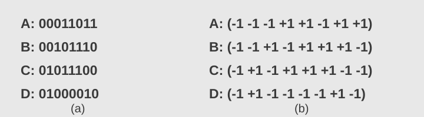

HW2
1. (10 points) Television channels are 14 MHz wide. How many bits/sec can be sent if 256-level digital signals are used? Assume a noiseless channel.  

By the Nyquist formula,

$$
R_{\max}=2B\log_2 M
=2(14\times10^6)\log_2 256
=224\times10^6\ \text{bits/s}
=224\ \text{Mbps}.
$$

2. (10 points) If a binary signal is sent over a 12-kHz channel whose signal-to-noise ratio is 30 dB, what is the maximum achievable data rate?

The linear signal-to-noise ratio is $S/N=10^{30/10}=1000$. The two limits are

$$
\begin{aligned}
R_{\mathrm{Nyquist}}&=2(12{,}000)\log_2 2=24{,}000\ \text{bits/s},\\
C_{\mathrm{Shannon}}&=12{,}000\log_2(1+1000)
\approx119{,}607\ \text{bits/s}.
\end{aligned}
$$

Thus $R_{\max}=\min(R_{\mathrm{Nyquist}},C_{\mathrm{Shannon}})=24{,}000\ \text{bits/s}=24\ \text{kbps}$.

3. (10 points) 10 signals, each requiring 4000 Hz, are multiplexed on to a single channel using FDM. How much minimum bandwidth is required for the multiplexed channel? Assume that the guard bands are 100 Hz wide.

Ten signals require nine intervening guard bands:

$$
B_{\min}=10(4000)+9(100)=40{,}900\ \text{Hz}=40.9\ \text{kHz}.
$$

4. (10 points) Suppose that A, B, and C are simultaneously transmitting 0 bits, using a CDMA system with the chip sequence of figure following:  
  
What is the resulting chip sequence? give your answer as (+x,-x,-x, ...)

Transmitting bit $0$ negates a station's chip sequence. Hence

$$
-A-B-C=(+3,+1,+1,-1,-3,-1,-1,+1).
$$

5. (20 points) A CDMA receiver gets the following chips: (-1 +1 -3 +1 -1 -3 +1 +1). Assuming the chip sequences defined in figure following,  
  
(a)Which bits did station A send? (bit 1, bit 0, or silence)   
(b)Which bits did station B send? (bit 1, bit 0, or silence)  
(c)Which bits did station C send? (bit 1, bit 0, or silence)  
(d)Which bits did station D send? (bit 1, bit 0, or silence)

For $r=(-1,+1,-3,+1,-1,-3,+1,+1)$, decode station $S$ using $r\cdot S/8$:

| Station | $r\cdot S$ | $r\cdot S/8$ | Transmission |
|---|---:|---:|---|
| A | $+8$ | $+1$ | Bit $1$ |
| B | $-8$ | $-1$ | Bit $0$ |
| C | $0$ | $0$ | Silence |
| D | $+8$ | $+1$ | Bit $1$ |

6. (10 points) What is the percent overhead on a T1 carrier; that is, what percent of the 1.544 Mbps are not delivered to the end user?

With $7$ payload bits and $1$ control bit per channel, each T1 frame contains $24\times8+1=193$ bits, of which $24\times7=168$ are payload.

$$
\text{Overhead}=\frac{193-168}{193}\times100\%
=\frac{25}{193}\times100\%\approx13.0\%.
$$

7. (10 points) A What is the percent overhead on a E1 carrier; that is, what percent of the 2.048 Mbps are not delivered to the end user? (round to one decimal place)

An E1 frame has $32$ eight-bit time slots: $30$ carry user data and $2$ carry framing and signaling.

$$
\text{Overhead}=\frac{2}{32}\times100\%=6.25\%\approx6.3\%.
$$

8. (10 points) Why has the PCM sampling time been set at 125 µsec?

A telephone voice channel has a bandwidth of approximately $4\ \text{kHz}$. Nyquist sampling requires $f_s\geq2B$; choosing $f_s=8000\ \text{Hz}$ gives

$$
T_s=\frac{1}{8000}\ \text{s}=125\ \mu\text{s}.
$$

9. (10 points) A simple telephone system consists of two end offices and a single toll office to which each end office is connected by a 1-MHz full-duplex trunk. The average telephone is used to make four calls per 8-hour workday. The mean call duration is 6 min. Ten percent of the calls are long-distance (i.e., pass through the toll office). What is the maximum number of telephones an end office can support? (Assume 4 kHz per circuit.)

The trunk supports

$$
n_{\mathrm{circuits}}=\frac{1{,}000{,}000}{4000}=250.
$$

Each telephone's average long-distance circuit occupancy is

$$
a=\frac{4\times6}{8\times60}\times0.10=0.005.
$$

Therefore, the maximum number of telephones per end office is

$$
N_{\max}=\frac{250}{0.005}=50{,}000.
$$
