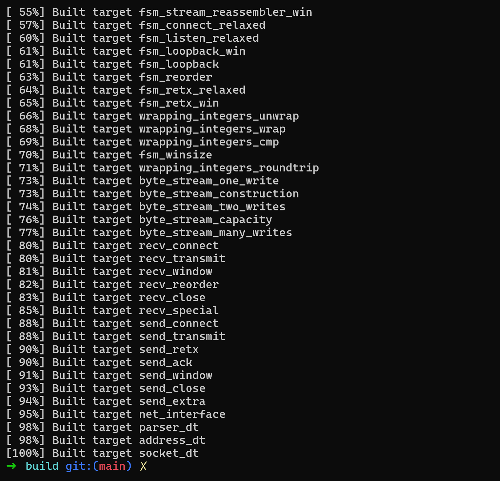
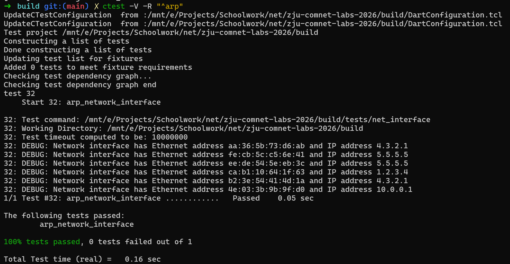
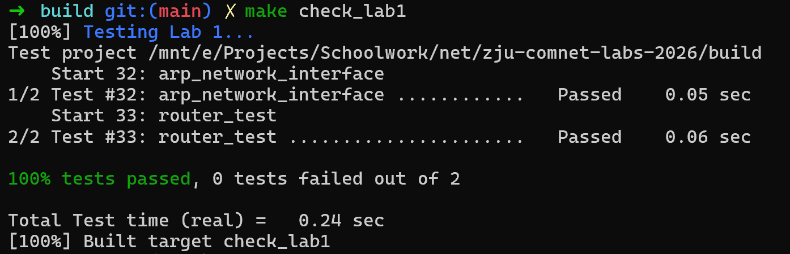

import Excalidraw from "@md-comp/Excalidraw.vue";
import sendDatagramUrl from "./send-datagram.excalidraw?url";
import recvFrameUrl from "./recv-frame.excalidraw?url";
import routeOneDatagramUrl from "./route-one-datagram.excalidraw?url";

# Lab3 网络接口与 IP 路由器

## 实验目的

- 学习掌握网络接口的工作原理
- 学习掌握 ARP 地址解析协议相关知识
- 学习掌握 IP 路由的工作原理

## 实验内容

- 实现 network interface，为每个下一跳地址查找（和缓存）以太网地址，即实现地址解析协议 ARP。
- 实现简易路由器，对于给定的数据包，确认发送接口以及下一跳的 IP 地址。

## 主要仪器设备

- 联网的 PC 机
- Linux 虚拟机（本实验使用 Windows 下的 WSL 环境进行编译与测试）

## 操作方法与实验步骤

### 1. 阅读辅助代码

在编写代码之前，首先阅读了 `libsponge/tcp_helpers/` 目录下与本实验相关的几个辅助类：

| 文件 | 作用 |
| --- | --- |
| `ethernet_header.hh` | 定义以太网首部 `EthernetHeader`，包含 `dst`、`src`、`type` 三个字段，以及 `TYPE_IPv4 = 0x800`、`TYPE_ARP = 0x806` 两个类型常量和广播地址 `ETHERNET_BROADCAST` |
| `ethernet_frame.hh` | 定义以太网帧 `EthernetFrame`，由首部 `header()` 和负载 `payload()`（`BufferList` 类型）组成 |
| `ipv4_datagram.hh` | 定义 `InternetDatagram`，提供 `serialize()` 将数据报序列化为 `BufferList`，`parse()` 从 `Buffer` 中解析数据报 |
| `arp_message.hh` | 定义 `ARPMessage`，包含 `opcode`（`OPCODE_REQUEST`/`OPCODE_REPLY`）、发送方/目标方的以太网地址与 IP 地址，并提供 `serialize()` 与 `parse()` |

通过阅读这些代码可以明确：网络接口发送数据时，需要把 `InternetDatagram` 或 `ARPMessage` 序列化后作为以太网帧的负载，并正确设置帧首部的源 MAC、目的 MAC 与类型字段；接收时则根据帧类型选择相应的 `parse()` 进行反序列化。

### 2. 实现网络接口（Network Interface）

#### 2.1 数据结构设计

在 `libsponge/network_interface.hh` 中为 `NetworkInterface` 类添加了以下私有成员：

```cpp
//! ARP cache entry lifetime (ms)
static constexpr size_t ARP_ENTRY_TTL_MS = 30 * 1000;

//! Minimum interval between ARP requests for the same IP (ms)
static constexpr size_t ARP_REQUEST_TTL_MS = 5 * 1000;

struct ArpEntry {
    EthernetAddress eth_addr;
    size_t ttl_ms;
};

//! ARP cache: IPv4 address (numeric) -> {Ethernet address, remaining lifetime}
std::map<uint32_t, ArpEntry> _arp_table{};

//! Outstanding ARP requests: IPv4 address -> remaining time before a new request may be sent
std::map<uint32_t, size_t> _arp_requests{};

//! Datagrams waiting for ARP resolution: IPv4 address of next hop -> datagrams
std::map<uint32_t, std::list<InternetDatagram>> _pending_datagrams{};
```

各成员的含义如下：

- `_arp_table`：ARP 缓存表，以 32 位数值形式的 IP 地址为键，值为对应的 MAC 地址和该表项的**剩余有效时间**（初始 30 秒）。
- `_arp_requests`：记录最近已发出 ARP 请求的 IP 地址及其**剩余冷却时间**（初始 5 秒）。只要某 IP 仍在该表中，就不会重复发送 ARP 请求。
- `_pending_datagrams`：等待 ARP 解析的数据报队列，按下一跳 IP 分组，收到对应映射后统一发出。

这里使用"剩余时间"而不是"记录时间戳"的方式，是因为本实验的时间完全由 `tick()` 驱动，每次 tick 时直接减去流逝的毫秒数即可，判断过期只需比较是否小于等于本次流逝时间，逻辑简单直观。

此外还添加了两个辅助函数：

```cpp
void NetworkInterface::_send_frame(const EthernetAddress &dst, const uint16_t type, BufferList &&payload) {
    EthernetFrame frame;
    frame.header().src = _ethernet_address;
    frame.header().dst = dst;
    frame.header().type = type;
    frame.payload() = std::move(payload);
    _frames_out.push(std::move(frame));
}

void NetworkInterface::_send_arp(const uint16_t opcode, const EthernetAddress &target_eth, const uint32_t target_ip) {
    ARPMessage msg;
    msg.opcode = opcode;
    msg.sender_ethernet_address = _ethernet_address;
    msg.sender_ip_address = _ip_address.ipv4_numeric();
    // In a request the target hardware address is unknown, so it is left as all zeros.
    msg.target_ethernet_address = (opcode == ARPMessage::OPCODE_REQUEST) ? EthernetAddress{} : target_eth;
    msg.target_ip_address = target_ip;

    const EthernetAddress frame_dst = (opcode == ARPMessage::OPCODE_REQUEST) ? ETHERNET_BROADCAST : target_eth;
    _send_frame(frame_dst, EthernetHeader::TYPE_ARP, BufferList(msg.serialize()));
}
```

- `_send_frame()` 负责组装以太网帧：源地址固定为本接口 MAC，填入目的地址、类型和负载后压入 `_frames_out` 队列（压入队列即视为"发送"）。
- `_send_arp()` 负责组装 ARP 报文：ARP 请求的目标 MAC 未知，填全 0，并且以太网帧目的地址为广播地址 `ff:ff:ff:ff:ff:ff`；ARP 应答的目标 MAC 已知，以单播方式发送给请求方。

#### 2.2 发送数据报 `send_datagram()`

```cpp
void NetworkInterface::send_datagram(const InternetDatagram &dgram, const Address &next_hop) {
    const uint32_t next_hop_ip = next_hop.ipv4_numeric();

    // Known mapping: send immediately
    const auto it = _arp_table.find(next_hop_ip);
    if (it != _arp_table.end()) {
        _send_frame(it->second.eth_addr, EthernetHeader::TYPE_IPv4, dgram.serialize());
        return;
    }

    // Unknown mapping: queue the datagram until the ARP reply arrives
    _pending_datagrams[next_hop_ip].push_back(dgram);

    // Only broadcast a new ARP request if none was sent for this IP in the last 5 seconds
    if (_arp_requests.find(next_hop_ip) == _arp_requests.end()) {
        _send_arp(ARPMessage::OPCODE_REQUEST, {}, next_hop_ip);
        _arp_requests[next_hop_ip] = ARP_REQUEST_TTL_MS;
    }
}
```

处理逻辑：

1. 将下一跳地址转换为 32 位整数，在 ARP 缓存表中查找。
2. 若命中，直接以该 MAC 为目的地址，封装类型为 `TYPE_IPv4` 的以太网帧发送。
3. 若未命中，先把数据报加入该下一跳的等待队列；再检查 5 秒内是否已为该 IP 发送过 ARP 请求，若没有则广播一个 ARP 请求并记录，否则只缓存不重复请求。

<Excalidraw src={sendDatagramUrl} height="680px" />

*图：send_datagram 处理流程*

#### 2.3 接收以太网帧 `recv_frame()`

```cpp
optional<InternetDatagram> NetworkInterface::recv_frame(const EthernetFrame &frame) {
    const auto &header = frame.header();

    // Drop frames not addressed to us (unicast) or broadcast
    if (header.dst != _ethernet_address && header.dst != ETHERNET_BROADCAST) {
        return nullopt;
    }

    if (header.type == EthernetHeader::TYPE_IPv4) {
        InternetDatagram dgram;
        if (dgram.parse(Buffer(frame.payload().concatenate())) == ParseResult::NoError) {
            return dgram;
        }
        return nullopt;
    }

    if (header.type == EthernetHeader::TYPE_ARP) {
        ARPMessage msg;
        if (msg.parse(Buffer(frame.payload().concatenate())) != ParseResult::NoError) {
            return nullopt;
        }

        const uint32_t sender_ip = msg.sender_ip_address;
        const EthernetAddress sender_eth = msg.sender_ethernet_address;

        // Learn (or refresh) the sender's mapping
        _arp_table[sender_ip] = ArpEntry{sender_eth, ARP_ENTRY_TTL_MS};
        _arp_requests.erase(sender_ip);

        // Flush datagrams that were waiting for this mapping
        const auto pending = _pending_datagrams.find(sender_ip);
        if (pending != _pending_datagrams.end()) {
            for (const auto &dgram : pending->second) {
                _send_frame(sender_eth, EthernetHeader::TYPE_IPv4, dgram.serialize());
            }
            _pending_datagrams.erase(pending);
        }

        // Reply only to requests asking for our own IP address
        if (msg.opcode == ARPMessage::OPCODE_REQUEST && msg.target_ip_address == _ip_address.ipv4_numeric()) {
            _send_arp(ARPMessage::OPCODE_REPLY, sender_eth, sender_ip);
        }
    }

    return nullopt;
}
```

处理逻辑：

1. **过滤**：目的 MAC 既不是本接口地址也不是广播地址的帧直接丢弃。
2. **IPv4 帧**：解析负载为 `InternetDatagram`，解析成功则返回给上层（网络层）。
3. **ARP 帧**：
   - 解析失败直接丢弃；
   - 无论是请求还是应答，都学习发送方的 IP→MAC 映射，有效期 30 秒；同时清除该 IP 的待应答请求记录；
   - 将等待该映射的所有缓存数据报依次封装发送；
   - 只有当报文是 ARP 请求、且询问的正是本接口 IP 时，才单播回复 ARP 应答。

需要说明的是，帧负载类型为 `BufferList`，可能由多段不连续的 `Buffer` 组成，而 `BufferList` 到 `Buffer` 的隐式转换在不连续时会抛出异常，因此这里先调用 `concatenate()` 拼接为连续字符串后再解析，保证鲁棒性。

<Excalidraw src={recvFrameUrl} height="760px" />

*图：recv_frame 处理流程*

#### 2.4 时间推进 `tick()`

```cpp
void NetworkInterface::tick(const size_t ms_since_last_tick) {
    // Age the ARP cache, removing expired mappings
    for (auto it = _arp_table.begin(); it != _arp_table.end();) {
        if (it->second.ttl_ms <= ms_since_last_tick) {
            it = _arp_table.erase(it);
        } else {
            it->second.ttl_ms -= ms_since_last_tick;
            ++it;
        }
    }

    // Age outstanding ARP requests so that a new request can be sent after 5 seconds
    for (auto it = _arp_requests.begin(); it != _arp_requests.end();) {
        if (it->second <= ms_since_last_tick) {
            it = _arp_requests.erase(it);
        } else {
            it->second -= ms_since_last_tick;
            ++it;
        }
    }
}
```

`tick()` 分别遍历 ARP 缓存表和 ARP 请求记录：剩余时间不足本次流逝时间的表项直接删除，其余表项减去流逝时间。由于剩余时间为无符号类型 `size_t`，先比较再相减可以避免下溢。遍历中删除元素时使用 `erase()` 的返回值更新迭代器，避免迭代器失效。

### 3. 实现简易路由器（Router）

#### 3.1 路由表数据结构

在 `libsponge/router.hh` 中为 `Router` 类添加了路由表：

```cpp
//! A single entry of the routing table
struct RouteEntry {
    uint32_t route_prefix;
    uint8_t prefix_length;
    std::optional<Address> next_hop;
    size_t interface_num;
};

//! The routing table
std::vector<RouteEntry> _routes{};
```

每个 `RouteEntry` 对应路由表中的一行，四个字段分别为目的网络前缀、前缀长度、下一跳（为空表示直连）和输出接口号。

#### 3.2 添加路由 `add_route()`

```cpp
void Router::add_route(const uint32_t route_prefix,
                       const uint8_t prefix_length,
                       const optional<Address> next_hop,
                       const size_t interface_num) {
    cerr << "DEBUG: adding route " << ... << "\n";

    _routes.push_back(RouteEntry{route_prefix, prefix_length, next_hop, interface_num});
}
```

直接将参数构造为 `RouteEntry` 追加到路由表末尾。

#### 3.3 转发数据报 `route_one_datagram()`

```cpp
void Router::route_one_datagram(InternetDatagram &dgram) {
    auto &header = dgram.header();

    // Drop datagrams whose TTL would reach zero
    if (header.ttl <= 1) {
        return;
    }

    const uint32_t dst = header.dst;

    // Longest prefix match
    const RouteEntry *best = nullptr;
    for (const auto &route : _routes) {
        // prefix_length == 0 matches everything; avoid undefined shift by 32
        const uint32_t mask = (route.prefix_length == 0) ? 0 : (0xffffffffu << (32 - route.prefix_length));
        if ((dst & mask) != (route.route_prefix & mask)) {
            continue;
        }
        if (best == nullptr || route.prefix_length > best->prefix_length) {
            best = &route;
        }
    }

    if (best == nullptr) {
        return;
    }

    // Checksum is recomputed on serialization
    header.ttl -= 1;

    const Address next_hop = best->next_hop.has_value() ? best->next_hop.value() : Address::from_ipv4_numeric(dst);
    _interfaces.at(best->interface_num).send_datagram(dgram, next_hop);
}
```

处理逻辑：

1. **TTL 检查**：TTL ≤ 1 的数据报转发后 TTL 将变为 0，直接丢弃。
2. **最长前缀匹配**：对每条路由，根据前缀长度生成掩码 `mask`（高 `prefix_length` 位为 1），若 `dst & mask == route_prefix & mask` 则匹配；在所有匹配项中保留 `prefix_length` 最大的一条。
   - 比较时对 `route_prefix` 同样做掩码运算，而不是直接比较 `dst & mask == route_prefix`。这是因为路由前缀的低位不一定为 0，例如测试中存在 `128.30.76.255/16` 这样的路由，只有高 16 位有意义。
   - 特别地，当 `prefix_length == 0`（默认路由 `0.0.0.0/0`）时，若直接计算 `0xffffffff << 32`，在 C++ 中对 32 位整数移位 32 位属于**未定义行为**，因此单独处理为掩码 0，使其能匹配任意地址。
3. **无匹配**：丢弃数据报。
4. **转发**：TTL 减 1（IPv4 首部校验和会在序列化时重新计算）；若路由有下一跳则使用该地址，否则（直连网络）以数据报的目的 IP 作为下一跳；最后调用对应接口的 `send_datagram()`，由该接口负责 ARP 解析与成帧发送。

<Excalidraw src={routeOneDatagramUrl} height="880px" />

*图：route_one_datagram 处理流程*

### 4. 编译与测试




两个测试截图见“实验结果与分析”部分

## <span id='result'> 实验结果与分析 </span>

### 1. ARP 网络接口测试

在 `build/` 目录中运行 `ctest -V -R "^arp"`，测试程序 `tests/net_interface` 依次构造了 6 个网络接口并执行以下测试场景：

| 测试场景 | 验证内容 |
| --- | --- |
| typical ARP workflow | 未知映射时广播 ARP 请求；收到应答后发出缓存的数据报；之后直接发送 |
| reply to ARP request | 收到询问本机 IP 的 ARP 请求时回复应答；询问其他 IP 时不回复 |
| learn from ARP request | 从 ARP 请求中学习发送方的映射 |
| pending mappings last five seconds | 5 秒内不重复发送 ARP 请求，超过 5 秒后可以再次请求 |
| active mappings last 30 seconds | ARP 缓存表项 30 秒内有效，超时后需要重新发送 ARP 请求 |
| different ARP mappings are independent | 不同 IP 的映射和过期时间互不干扰 |



输出中的 6 行 `DEBUG` 信息分别对应上述 6 个测试场景中构造的网络接口（IP 地址依次为 4.3.2.1、5.5.5.5、5.5.5.5、1.2.3.4、4.3.2.1、10.0.0.1），最终 `arp_network_interface` 测试通过，说明网络接口的 ARP 请求、应答、学习、缓存过期、请求限流等功能均符合要求。

以 "pending mappings last five seconds" 为例分析：第 0 ms 发送数据报触发 ARP 请求；第 4990 ms 再次发送同一下一跳的数据报，此时 `_arp_requests` 中该 IP 的剩余时间为 10 ms，因此不发送新请求；再经过 20 ms 后，剩余时间不足，该记录在 `tick()` 中被删除，此后发送数据报会重新广播 ARP 请求。这与实现中"剩余时间 ≤ 流逝时间即删除"的逻辑完全一致。

### 2. make check_lab1 测试结果



### 思考题

#### 1. 通过代码，请描述 network interface 是如何发送一个以太网帧的？

上层调用 `send_datagram(dgram, next_hop)` 后，网络接口按以下步骤发送以太网帧：

1. **确定目的 MAC**：将下一跳地址 `next_hop` 通过 `ipv4_numeric()` 转换为 32 位整数，在 ARP 缓存表 `_arp_table` 中查找对应的 MAC 地址。
2. **已知映射时直接发送**：调用 `_send_frame()` 组装以太网帧——
   - `header().src` 设为本接口的 MAC 地址 `_ethernet_address`；
   - `header().dst` 设为缓存表中查到的下一跳 MAC 地址；
   - `header().type` 设为 `EthernetHeader::TYPE_IPv4`；
   - `payload()` 设为 `dgram.serialize()` 得到的序列化数据报；

   然后将该帧压入 `_frames_out` 队列，由外部（测试程序或真实的网卡驱动）取出并发送到链路上。
3. **未知映射时先进行 ARP 解析**：将数据报暂存到 `_pending_datagrams[next_hop_ip]`，并（在 5 秒限流允许时）广播一个 ARP 请求帧。该帧的类型为 `TYPE_ARP`，目的 MAC 为广播地址 `ff:ff:ff:ff:ff:ff`，负载为序列化后的 `ARPMessage`（`opcode = OPCODE_REQUEST`，发送方填本机 MAC/IP，目标 IP 填 `next_hop_ip`，目标 MAC 填全 0）。
4. **收到应答后补发**：当 `recv_frame()` 收到下一跳的 ARP 应答（或请求）时，学习其 MAC 地址，然后把 `_pending_datagrams` 中等待该 IP 的数据报依次按第 2 步的方式封装为 IPv4 以太网帧发送出去。

#### 2. 当 network interface 发送一个 ARP 请求后如果没收到应答该怎么解决？

本实验中只做了"5 秒内不重复请求"的限流处理，并没有处理请求一直无应答的情况。目前的实现中，若一直收不到应答，数据报会一直滞留在 `_pending_datagrams` 中，只有当上层再次向该下一跳发送数据报时才会重新触发 ARP 请求。

可以考虑以下几个解决方案：

1. **超时重传**：在 `tick()` 中检测 ARP 请求记录过期时，如果该 IP 仍有待发送的数据报，则主动重新广播 ARP 请求，而不是被动等待上层再次调用 `send_datagram()`。
2. **限制重传次数，失败后丢弃**：为每个待解析 IP 记录重传次数，超过上限（如 3 次）后认为该主机不可达，丢弃 `_pending_datagrams` 中对应的所有数据报。对于路由器而言，还应向数据报的源主机返回 ICMP "目的主机不可达"（Destination Host Unreachable）报文，让发送方及时得知失败原因。Linux 中的 `ucast_solicit`/`mcast_solicit` 参数即用于控制此重传次数。
3. **指数退避**：重传间隔可以逐次加倍，避免在目标主机长期离线时不断在局域网内广播，造成广播风暴。
4. **负缓存**：解析失败后，可以短时间内把该 IP 标记为"不可达"（类似 Linux 邻居表中的 `FAILED` 状态），在此期间新到的数据报直接丢弃并报告错误，而不是重复发起请求。
5. **限制缓存队列长度**：为每个 IP 的待发送队列设置上限（如 Linux 中默认每个邻居最多缓存若干个数据报），超过上限时丢弃最早的数据报，防止内存耗尽。

#### 3. 请描述一下你为了记录路由表所建立的数据结构？为什么？

本实验使用 `std::vector<RouteEntry>` 存储路由表，每个 `RouteEntry` 包含：

```cpp
struct RouteEntry {
    uint32_t route_prefix;           // 目的网络前缀
    uint8_t prefix_length;           // 前缀长度
    std::optional<Address> next_hop; // 下一跳，为空表示直连
    size_t interface_num;            // 输出接口编号
};
```

选择这种结构的原因：

1. **与路由表的概念一一对应**：每个结构体正好对应路由表中的一行，字段与 `add_route()` 的参数一致，代码直观、易于理解和调试。
2. **`std::optional<Address>` 准确表达"直连"语义**：下一跳可能不存在，使用 `optional` 比用特殊值（如 `0.0.0.0`）表示更安全、语义更清晰。
3. **实现简单且正确性容易保证**：路由时线性遍历所有表项，计算掩码比较前缀，保留最长匹配，时间复杂度为 O(n)。在本实验的规模下（每个路由器只有几条到十几条路由），性能完全足够。
4. **插入开销低**：`add_route()` 只需 `push_back`，均摊 O(1)。

不足与可改进之处：线性查找在真实路由器中（路由表可能有数十万条）效率太低。可以改进为：

- **按前缀长度分组的哈希表**：建立 33 个哈希表（对应前缀长度 0~32），查找时从 32 到 0 依次用 `dst & mask` 查对应哈希表，首次命中即为最长匹配，最多 33 次 O(1) 查找。
- **前缀树（Trie）**：以目的地址的二进制位为路径构建二叉字典树，沿目的 IP 的比特向下走，记录经过的最后一个有路由的节点即为最长匹配，查找复杂度为 O(32)，与路由表规模无关。进一步可使用路径压缩的 Patricia Trie 或多比特 Trie 减少内存与访问次数，这也是实际路由器软件常用的方案。

## 讨论、心得

本次实验实现了网络接口中的 ARP 协议和一个基于最长前缀匹配的简易路由器，使我对网络层与链路层的交互有了更具体的认识：IP 数据报中保存的是端到端的源/目的 IP 地址，而每一跳传输时以太网帧首部中的 MAC 地址都在变化；ARP 正是连接这两层地址的桥梁，而路由器只负责决定"下一跳是谁、从哪个接口发出"，真正的成帧与地址解析交由网络接口完成。

实验中遇到的问题与解决方法：

1. **ARP 请求限流与缓存过期的计时方式**：本实验没有全局时钟，时间完全由 `tick()` 推进，因此选择记录"剩余有效时间"，每次 tick 时递减、不足则删除，实现更简单。同时需要注意 `size_t` 是无符号类型，必须先比较再相减，否则会发生下溢变成一个极大的数，导致表项永不过期。
2. **`BufferList` 转 `Buffer` 可能抛出异常**：阅读 `buffer.hh` 发现 `BufferList` 到 `Buffer` 的隐式转换在数据不连续时会抛异常。虽然测试中的帧负载都是连续的，但为了鲁棒性，解析前先调用 `concatenate()` 将其拼接为一个连续的 `Buffer`。
3. **默认路由的移位问题**：计算掩码时 `0xffffffff << (32 - prefix_length)` 在 `prefix_length == 0` 时会移位 32 位，这在 C++ 中是未定义行为（在 x86 上实际上常常等价于移位 0 位，得到全 1 掩码，使默认路由几乎无法匹配）。因此对前缀长度为 0 的情况单独处理为掩码 0。


总体来说，本次实验的代码量不大，但需要对协议细节（何时广播、何时单播、何时学习、何时回复、何时过期）有准确的把握。