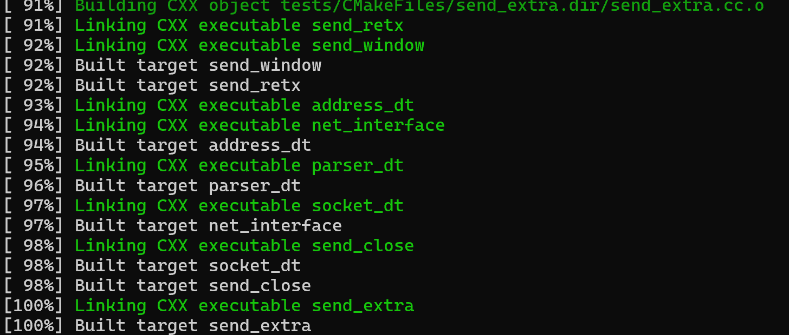
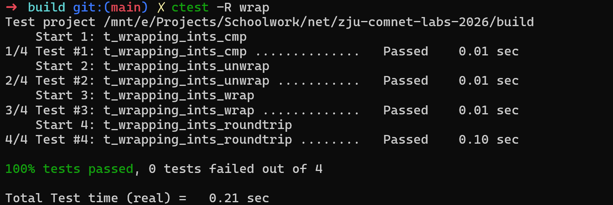
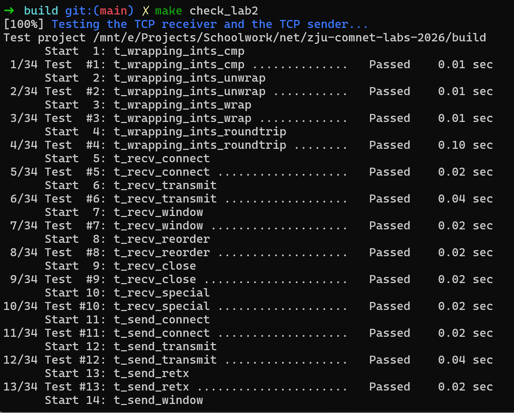
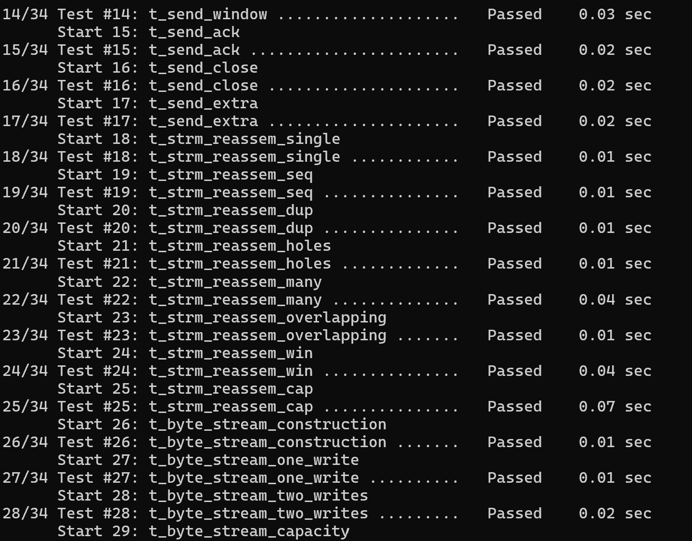
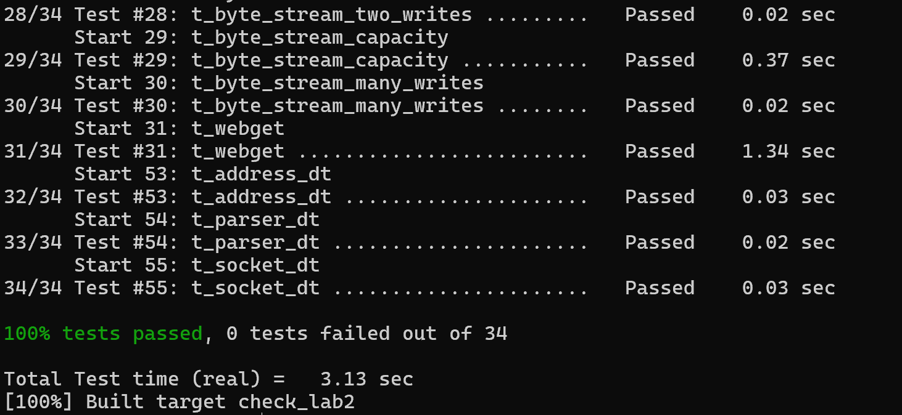

# Lab 4 TCP 接收方（Receiver）与发送方（Sender）

## 实验目的

- 学习掌握TCP的工作原理
- 学习掌握流重组器的工作原理
- 学习掌握TCP receiver和TCP sender的相关知识

## 实验内容

- 实现流重组器，一个将字节流的字串或小段按照正确顺序来拼接回连续字节流的模块。
- 实现TCPReceiver。
  - 接收TCPsegment；
  - 重新组装字节流；
  - 确定应该发回发送者的信号，以进行数据确认和流量控制。
- 实现TCPSender：
  - 将ByteStream中的数据以TCP报文形式持续发送给接收者；
  - 处理TCPReceiver传入的ackno和window size，以追踪接收者当前的接收状态，以及检测丢包的情况；
  - 若经过一个超时时间仍然没有接收到TCPReceiver发送的ack包，则重传。
  - 发送一个空段

## 主要仪器设备

- 联网的PC机
- Linux虚拟机

## 操作方法与实验步骤

### 序号转换 WrappingInt32

#### wrap

绝对序号加上 ISN 后对 2^32 取模即可，直接利用 `uint32_t` 的自然溢出实现：

```cpp
WrappingInt32 wrap(uint64_t n, WrappingInt32 isn) {
    return WrappingInt32{isn.raw_value() + static_cast<uint32_t>(n)};
}
```

#### unwrap


```cpp
uint64_t unwrap(WrappingInt32 n, WrappingInt32 isn, uint64_t checkpoint) {
    const uint32_t offset = n.raw_value() - isn.raw_value();
    const uint64_t base = checkpoint & 0xFFFFFFFF00000000ULL;
    uint64_t candidate = base | offset;
    const uint64_t step = 1ULL << 32;
    uint64_t best = candidate;
    uint64_t best_dist = candidate > checkpoint ? candidate - checkpoint : checkpoint - candidate;
    if (candidate >= step) {               // 候选 - 2^32（防止下溢）
        const uint64_t lower = candidate - step;
        const uint64_t dist = lower > checkpoint ? lower - checkpoint : checkpoint - lower;
        if (dist < best_dist) { best = lower; best_dist = dist; }
    }
    {                                      // 候选 + 2^32
        const uint64_t upper = candidate + step;
        const uint64_t dist = upper > checkpoint ? upper - checkpoint : checkpoint - upper;
        if (dist < best_dist) { best = upper; best_dist = dist; }
    }
    return best;
}
```
由于一个 32 位序号对应无穷多个绝对序号（每隔 2^32 一个），需要用 `checkpoint`（最近一次用到的绝对序号）来消歧义，选择距离 `checkpoint` 最近的那一个。

实现思路：

1. `offset = n - isn`（32 位无符号减法）得到答案的低 32 位。
2. 取 `checkpoint` 的高 32 位与 `offset` 拼接得到候选值 `candidate`。
3. 真正的答案一定是 `candidate`、`candidate - 2^32`、`candidate + 2^32` 三者之一，逐一计算与 `checkpoint` 的绝对距离，取最小者。

### TCPReceiver

#### segment_received

```cpp
void TCPReceiver::segment_received(const TCPSegment &seg) {
    const TCPHeader &header = seg.header();
    if (!_syn_received) {                 // 握手前只关心 SYN
        if (!header.syn) return;
        _syn_received = true;
        _isn = header.seqno;
    }
    const uint64_t checkpoint = stream_out().bytes_written() + 1;
    const uint64_t abs_seqno = unwrap(header.seqno, _isn, checkpoint);
    if (!header.syn && abs_seqno == 0) return;   // 非 SYN 报文不可能占据绝对序号 0
    const uint64_t stream_index = header.syn ? abs_seqno : abs_seqno - 1;
    _reassembler.push_substring(seg.payload().copy(), stream_index, header.fin);
}
```

- checkpoint 的选取：`bytes_written() + 1` 即下一个期待的绝对序号，是最近的合法参考点。
- 流下标转换：SYN 占据绝对序号 0，所以普通数据的流下标 = 绝对序号 − 1；若报文自身带 SYN，其载荷紧跟 SYN 之后，流下标恰好等于绝对序号（即 0）。
- FIN 处理：直接把 `header.fin` 作为 `eof` 传给重组器，由重组器判断何时真正结束流。

#### ackno 与 window_size

```cpp
optional<WrappingInt32> TCPReceiver::ackno() const {
    if (!_syn_received) return nullopt;
    uint64_t abs_ackno = stream_out().bytes_written() + 1;  // +1 for SYN
    if (stream_out().input_ended()) abs_ackno += 1;        // +1 for FIN
    return wrap(abs_ackno, _isn);
}
size_t TCPReceiver::window_size() const { return _capacity - stream_out().buffer_size(); }
```


### TCPSender

#### 统一的发送出口 send_segment

所有占据序号空间的段都通过这个私有函数发出，保证记账逻辑集中在一处：

```cpp
void TCPSender::send_segment(TCPSegment &seg) {
    seg.header().seqno = wrap(_next_seqno, _isn);   // 盖上序号
    const size_t len = seg.length_in_sequence_space();
    _next_seqno += len;
    _bytes_in_flight += len;
    _segments_out.push(seg);                        // 交给 TCPConnection 真正发送
    _outstanding_segments.push(seg);                // 留一份副本等待确认
    if (!_timer_running) {                          // 计时器未运行则启动
        _timer_running = true;
        _timer_elapsed = 0;
    }
}
```

#### fill_window

```cpp
void TCPSender::fill_window() {
    if (_fin_sent) return;
    const uint64_t effective_window = _window_size == 0 ? 1 : _window_size;  // 零窗口当 1 处理
    while (true) {
        const uint64_t right_edge = _last_ackno + effective_window;
        if (right_edge <= _next_seqno) break;             // 窗口已满
        uint64_t remaining = right_edge - _next_seqno;
        TCPSegment seg;
        if (!_syn_sent) {                                 // 第一个段只带 SYN
            seg.header().syn = true;
            _syn_sent = true;
            send_segment(seg);
            continue;
        }
        const size_t payload_size = min({uint64_t(TCPConfig::MAX_PAYLOAD_SIZE),
                                         remaining, uint64_t(_stream.buffer_size())});
        if (payload_size > 0) {
            seg.payload() = Buffer(_stream.read(payload_size));
            remaining -= payload_size;
        }
        if (!_fin_sent && _stream.eof() && remaining > 0) {  // 流结束且窗口还有空位则带上 FIN
            seg.header().fin = true;
            _fin_sent = true;
        }
        if (seg.length_in_sequence_space() == 0) break;   // 无东西可发
        send_segment(seg);
        if (_fin_sent) break;
    }
}
```

- 窗口右边界 = `_last_ackno + window`，可发送量 = 右边界 − `_next_seqno`。
- 零窗口按 1 处理，这样在对端窗口为 0 时仍会发出 1 字节“探测”，否则永远收不到窗口更新。
- 单个段载荷不超过 `MAX_PAYLOAD_SIZE`(1000)，大数据会被切成多个段循环发出。
- FIN 也占 1 个序号，只有窗口还有剩余时才能附加，否则等下次窗口打开再发。


#### ack_received

```cpp
void TCPSender::ack_received(const WrappingInt32 ackno, const uint16_t window_size) {
    const uint64_t abs_ackno = unwrap(ackno, _isn, _next_seqno);
    if (abs_ackno > _next_seqno) return;     // 确认了没发过的数据：非法，忽略
    if (abs_ackno < _last_ackno) return;     // 过时的 ack：忽略
    _window_size = window_size;
    if (abs_ackno > _last_ackno) {           // 有新数据被确认
        _last_ackno = abs_ackno;
        while (!_outstanding_segments.empty()) {   // 弹出所有被完全确认的段
            const TCPSegment &front = _outstanding_segments.front();
            const uint64_t front_end = unwrap(front.header().seqno, _isn, _next_seqno)
                                       + front.length_in_sequence_space();
            if (front_end > abs_ackno) break;      // 只被部分确认，保留
            _bytes_in_flight -= front.length_in_sequence_space();
            _outstanding_segments.pop();
        }
        _rto = _initial_retransmission_timeout;    // 有进展：RTO 复位
        _consecutive_retransmissions = 0;
        _timer_running = !_outstanding_segments.empty();
        _timer_elapsed = 0;
    }
    fill_window();                                 // 窗口可能变大，尝试继续发
}
```

只有当某个段的**全部**序号都被确认时才将其移出队列，部分确认的段仍需整段重传；窗口大小无论 ack 是否推进都要更新。

#### tick 与超时重传

```cpp
void TCPSender::tick(const size_t ms_since_last_tick) {
    if (!_timer_running) return;
    _timer_elapsed += ms_since_last_tick;
    if (_timer_elapsed < _rto) return;
    if (!_outstanding_segments.empty()) {
        _segments_out.push(_outstanding_segments.front());   // 重传最早的未确认段
        if (_window_size != 0) {                             // 非零窗口才视为拥塞
            _consecutive_retransmissions += 1;
            _rto *= 2;                                       // 指数退避
        }
    }
    _timer_elapsed = 0;                                      // 重启计时器
}
```


#### send_empty_segment

```cpp
void TCPSender::send_empty_segment() {
    TCPSegment seg;
    seg.header().seqno = wrap(_next_seqno, _isn);
    _segments_out.push(seg);
}
```

生成一个 payload 长度为零、SYN 和 FIN 均未设置的 TCPSegment，seqno 设为当前 next_seqno 后放入 segments_out()；该段不占序列号空间，也不加入未确认队列。


### 编译与测试

编译完成输出如下：



## <span id='result'> 实验结果与分析 </span>

### ctest -R wrap 测试结果




### make check_lab2 测试结果







### 思考题

**通过代码，请描述 TCPSender 是如何发送出一个 segment 的？**

1. 根据 `_last_ackno + window - _next_seqno` 算出当前窗口还能容纳多少序号。
2. 新建一个 `TCPSegment`。若 SYN 尚未发送，置 `header().syn = true`；否则从 `_stream` 中 `read()` 出不超过 `min(MAX_PAYLOAD_SIZE, 剩余窗口, 流中字节数)` 的数据作为 `payload()`；若流已 `eof()` 且窗口仍有空位，置 `header().fin = true`。
3. 调用 `send_segment(seg)`：用 `wrap(_next_seqno, _isn)` 填入 `header().seqno`，按 `length_in_sequence_space()` 推进 `_next_seqno` 与 `_bytes_in_flight`，把段同时压入 `_segments_out`（待发送）和 `_outstanding_segments`（待确认），若计时器未运行则启动它。
4. 循环直到窗口填满、流中没有数据，或 FIN 已发出。

**请用自己的理解描述一下 TCPSender 超时重传的整个流程。**

- 每当有占序号的段被发出，若计时器未运行，就从 0 开始计时（`_timer_running = true, _timer_elapsed = 0`），初始 RTO 为构造时给定的 `retx_timeout`。
- 上层周期性调用 `tick(ms)`，累加 `_timer_elapsed`。只要未达到 `_rto` 就什么都不做。
- 一旦 `_timer_elapsed >= _rto`，说明最早发出的那个段在一个 RTO 内没有被确认，极可能丢失了。此时把 `_outstanding_segments.front()` 再次压入 `_segments_out` 重传（只重传最早那一个，而不是全部）。
- 若对端窗口不为 0，就认为网络拥塞：`_consecutive_retransmissions++`，`_rto *= 2`（指数退避），以降低对网络的压力。若窗口为 0，说明是接收方没空间，不是网络问题，RTO 和计数都不变。
- 把 `_timer_elapsed` 清零，重新计时。
- 当 `ack_received` 发现 ackno 推进了（有新数据被确认），则 RTO 恢复到初始值,连续重传次数清零，计时器重新开始；若此时已没有未确认的段，则停止计时器。
- 上层 `TCPConnection` 可通过 `consecutive_retransmissions()` 判断是否超过 `MAX_RETX_ATTEMPTS`，从而放弃连接。

**请描述一下你为了重传未被确认的段建立的数据结构？为什么？**

使用了 `std::queue<TCPSegment> _outstanding_segments`，配合 `uint64_t _bytes_in_flight` 和 `uint64_t _last_ackno`。

原因：
- 段总是按序号递增顺序发出，而 TCP 的累积确认也总是从最前面开始确认，因此“确认”操作就是不断弹出队头，“重传”操作只针对队头——FIFO 队列的 `front()/pop()/push()` 恰好且仅提供这几种操作，语义最贴切，且都是 O(1)。
- 保存完整的 `TCPSegment` 副本而不是只保存序号区间，是因为重传时需要原样重发整个段（含 SYN/FIN 标志和载荷）；而 `Buffer` 内部是引用计数的共享字符串，复制段的代价很小。
- 用单独的 `_bytes_in_flight` ，避免每次查询都遍历队列。
- 队列中各段互不重叠、整体连续，所以判断一个段是否被完全确认只需比较 `seqno + length <= ackno`，不需要更复杂的区间结构（如 map 或 set）。

**请思考为什么 TCPSender 实现中有一个发送空段的方法，能描述一下你是怎么理解的吗？**

TCPSender 和 TCPReceiver 是同一条连接的两个“半边”。接收方收到数据后需要回一个 ACK，告诉对方新的 ackno 和窗口大小；但 ackno 和窗口字段只能由本端的 TCPReceiver 提供，而“把段放进发送队列”这件事又只能由 TCPSender 做。当本端恰好没有数据要发时，就需要一个不携带任何数据、不占序号空间而且不需要被确认、不触发重传计时器的段作为 ACK 的载体——这就是 `send_empty_segment()`。

它的典型用途有：
- 收到对方数据后立即回 ACK（即使本端流为空）。
- 回应对方的窗口探测、或主动通告窗口更新。
- 握手/挥手过程中纯粹的确认段（如三次握手的第三个 ACK）。
- 收到非法段时发送 RST（在空段上置 rst 位）。

由于它 `length_in_sequence_space() == 0`，不进入 `_outstanding_segments`，可以直接丢弃，下一次有数据到达时自然会再回 ACK，这与 TCP“ACK 不被确认”的设计一致。

## 讨论、心得

本次实验把 TCP 的可靠传输部分完整地走了一遍，总的来说，整个实验让我对 TCP 的滑动窗口，累积确认以及超时重传与指数退避都有了较为直观的理解，特别是让我体会到 TCP 设计中许多“看起来多余”的细节其实都是为了解决真实的死锁或饥饿问题，比如零窗口探测、空 ACK 段这种。

