import Excalidraw from "@md-comp/Excalidraw.vue";
import word2vecPipelineUrl from "./word2vec-pipeline.excalidraw?url";
import skipgramUrl from "./skipgram-architecture.excalidraw?url";
import textcnnPipelineUrl from "./textcnn-pipeline.excalidraw?url";


## 1. Project Introduction

### （1）实验简介

本实验包含两个自然语言处理基础实验。

**Word2Vec 词向量训练实验。** 基于 Python 和 gensim 框架实现 Word2Vec 在 Wikipedia 语料集上面的应用。

**TextCNN 情感分析实验。** 基于 MindSpore 搭建 TextCNN 模型用于情感分析。

### （2）开发环境及系统运行要求

**Word2Vec 词向量实验**

- 软件环境：Python 3.7、Gensim。
- 开发环境：ModelArts Ascend Notebook 环境。
- 实际使用的具体环境：
  - 规格 `GPU: 1*Pnt1(16GB) | CPU: 8 核 64GB`；
  - 公共镜像 `mindquantum_0_11_0:mindquantum_0.11.0-cuda_12.4-py_3.11-ubuntu_22.04-x86_64-20251204191704-f7fdf41`

**TextCNN 情感分析实验**

- 软件环境：MindSpore 1.1。
- 开发环境：ModelArts Ascend Notebook 环境。
- 实际使用的具体环境：
  - 规格 `1 * Ascend Snt9 | 24 vCPUs | 96 GB`；
  - 公共镜像 `mindspore_1_7_0:mindspore_1.7.0-cann_5.1.0-py_3.7-euler_2.8.3-aarch64-d910-20220906`

## 2. Technical Details

### 2.1 Part 1：Word2Vec 词向量训练实验

#### 实验背景

词向量（Word embedding），又叫 Word 嵌入，是自然语言处理（NLP）中的一组语言建模和特征学习技术的统称，其中来自词汇表的单词或短语被映射到实数的向量。从概念上讲，它涉及从每个单词一维的空间到具有更低维度的连续向量空间的数学嵌入。

当用作底层输入表示时，单词和短语嵌入已经被证明可以提高 NLP 任务的性能，例如语法分析和情感分析。

#### 实验简介

Word2vec 是 Google 在 2013 年开源的一款用于词向量计算的工具，一经发布就引起了工业界和学术界的关注。首先，Word2vec 可以在百万数量级的词典和上亿的数据集上进行高效地训练；其次，该工具训练得到的词向量（word embedding），可以很好地度量词与词之间的相似性。Word2vec 不是一种深度学习算法，其后面只是一个浅层神经网络，包含两种模型：CBOW 模型和 Skip-gram 模型。

本章实验主要是基于 Python 和 gensim 框架实现 Word2vec 在 Wikipedia 语料集上面的应用，并且获取词的词向量以及寻找相近词。

#### （1）工程实践当中所用到的理论知识阐述

##### ① 词的表示：从 One-hot 到分布式表示

- **One-hot 表示**：设词表大小为 $|V|$，每个词表示为一个 $|V|$ 维向量，只有该词对应的位置为 1，其余为 0。这种表示维度极高且稀疏；任意两个不同词的向量都正交，内积恒为 0，因此无法刻画“北京”与“上海”之间的语义相近关系。
- **分布式表示（Distributed Representation）**：把每个词映射为一个低维（本实验为 100 维）、稠密的实数向量。语义相近的词在向量空间中距离也相近，因此可以直接用向量运算来度量相似度。

##### ② 分布式假设（Distributional Hypothesis）

Word2Vec 的理论基础是 Harris 和 Firth 提出的分布式假设：**“一个词的含义由它的上下文决定”**（You shall know a word by the company it keeps）。出现在相似上下文中的词，语义也相似。因此，只要训练模型用一个词去预测它的上下文（或者反过来），模型学到的中间表示就会带有语义信息。

##### ③ Word2Vec 的两种模型

Word2Vec 是一个只有一个隐藏层的浅层神经网络（隐藏层没有非线性激活）。设词表为 $V$，向量维度为 $d$。模型包含两个参数矩阵：输入词向量矩阵 $W_{in}\in\mathbb{R}^{|V|\times d}$ 和输出词向量矩阵 $W_{out}\in\mathbb{R}^{|V|\times d}$。训练完成后，一般把 $W_{in}$ 作为最终的词向量。

- **CBOW（Continuous Bag-of-Words）**：用上下文词预测中心词。先把窗口内上下文词的向量取平均（或求和）得到隐藏层 $h$，再预测中心词 $w_t$。CBOW 训练速度快，对高频词的效果较好。
- **Skip-gram**：用中心词预测上下文词。对于中心词 $w_t$，分别预测窗口 $[-c, c]$ 内的每一个上下文词 $w_{t+j}$。Skip-gram 训练较慢，但对低频词和小语料效果更好。**本实验使用 Skip-gram（`sg=1`）。**

Skip-gram 的目标是最大化语料中所有（中心词，上下文词）对的平均对数概率：

$$
J(\theta)=\frac{1}{T}\sum_{t=1}^{T}\sum_{-c\le j\le c,\ j\ne 0}\log P(w_{t+j}\mid w_t)
$$

其中条件概率用 Softmax 定义（$v$ 为输入向量，$u$ 为输出向量）：

$$
P(w_O\mid w_I)=\frac{\exp(u_{w_O}^{\top}v_{w_I})}{\sum_{w\in V}\exp(u_w^{\top}v_{w_I})}
$$

分母要对整个词表求和，计算代价是 $O(|V|)$。本实验词表约有 10 万词，直接计算不可行，所以需要下面的近似方法。

##### ④ 训练加速方法

1. **负采样（Negative Sampling，gensim 默认 `hs=0, negative=5`）**：不再计算完整的 Softmax，而是把问题转化为二分类：区分真实的（中心词，上下文词）对和随机采样的 $k$ 个“噪声词”。单个样本的目标函数为：
   $$
   \log\sigma(u_{w_O}^{\top}v_{w_I})+\sum_{i=1}^{k}\mathbb{E}_{w_i\sim P_n(w)}\big[\log\sigma(-u_{w_i}^{\top}v_{w_I})\big]
   $$
   其中 $\sigma$ 为 sigmoid 函数。噪声分布取 $P_n(w)\propto f(w)^{0.75}$（对应参数 `ns_exponent=0.75`），这样会适当提高低频词被采样的概率。每次更新的复杂度从 $O(|V|)$ 降到 $O(k)$。
2. **层次 Softmax（Hierarchical Softmax，`hs=1` 时启用）**：根据词频构建 Huffman 树，把 $|V|$ 分类转化为从根节点到叶子节点路径上的一串二分类，复杂度为 $O(\log|V|)$。本实验没有启用。
3. **高频词下采样（Subsampling，`sample=1e-3`）**：“的”“是”这类高频词信息量低、出现次数多。训练时以一定概率丢弃词 $w$，保留概率约为 $\left(\sqrt{f(w)/s}+1\right)\cdot s/f(w)$（$f(w)$ 为词频占比，$s$ 为阈值 `sample`）。这样既能加快训练，也能提升低频词向量的质量。
4. **动态窗口**：对每个中心词，实际使用的窗口大小在 $[1, \text{window}]$ 中均匀随机抽取。效果上，距离中心词越近的上下文词被采样得越频繁，相当于给近邻更大的权重。
5. **学习率线性衰减**：学习率从 `alpha=0.025` 随训练进度线性下降到 `min_alpha=0.0001`，用随机梯度下降（SGD）更新参数。

##### ⑤ 词向量相似度

训练得到词向量后，用**余弦相似度**度量两个词的语义相近程度：

$$
\cos(\mathbf{a},\mathbf{b})=\frac{\mathbf{a}\cdot\mathbf{b}}{\|\mathbf{a}\|\,\|\mathbf{b}\|}\in[-1,1]
$$

值越接近 1，两个词越相似。“寻找相近词”就是在整个词表中找出与目标词余弦相似度最高的 Top-N 个词。

#### （2）算法描述

##### ① 整体流程

<Excalidraw src={word2vecPipelineUrl} height="420px" />

*图：Word2Vec 训练与使用流程*

##### ② Skip-gram 网络结构示意

<Excalidraw src={skipgramUrl} height="240px" />

*图：Skip-gram 网络结构*

由于输入是 one-hot 向量，“输入层 × $W_{in}$”实际上就是从 $W_{in}$ 中取出第 $w_t$ 行，不需要真的做矩阵乘法。

#### （3）程序开发中的重要技术细节

1. **自己编写的功能代码**：本部分的核心算法全部由 gensim 库实现，没有另外定义函数。自己编写的代码主要是组织整个流程的脚本逻辑以及额外的探索性内容。

### 2.2 Part 2：TextCNN 情感分析实验

#### 实验背景

文本分类（text classification），又称文档分类（document classification），指的是将一个文档归类到一个或多个类别中的自然语言处理任务。文本分类的应用场景非常广泛，涵盖垃圾邮件过滤、垃圾评论过滤、自动标签、情感分析等任何需要自动归档文本的场合。

#### 实验简介

情感分析是自然语言处理文本分类任务的应用场景之一，情感分类较为简单，实用性也较强。常见的购物网站、电影网站都可以采集到相对高质量的数据集，也很容易给业务领域带来收益。例如，可以结合领域上下文，自动分析特定类型客户对当前产品的意见，可以分主题分用户类型对情感进行分析，以作针对性的处理，甚至基于此进一步推荐产品，提高转化率，带来更高的商业收益。

本实验主要基于卷积神经网络对电影评论信息进行情感分析，判断其情感倾向。

#### （1）工程实践当中所用到的理论知识阐述

##### ① 文本分类任务

文本分类就是学习一个映射 $f:\ x=(w_1,\dots,w_n)\rightarrow y\in\{1,\dots,C\}$。本实验是二分类（$C=2$，0 = 负面，1 = 正面）。

##### ② 词嵌入（Embedding）

神经网络不能直接处理字符串。首先建立词典 $V$，把每个词映射为一个整数索引；然后通过嵌入层把索引映射为 $d$ 维稠密向量：

$$
\mathbf{x}_i = E[w_i],\qquad E\in\mathbb{R}^{|V|\times d}
$$

一个长度为 $n$ 的句子就变成一个 $n\times d$ 的矩阵 $X$，可以把它看成一张“单通道图片”：高是词的位置，宽是词向量维度。本实验的嵌入矩阵 $E$ 是随机初始化（正态分布）的，和网络一起端到端训练，没有使用 Part 1 那样的预训练词向量（对应 Kim 2014 论文中的 **CNN-rand** 设置）。

##### ③ 卷积神经网络用于文本：TextCNN

TextCNN 由 Yoon Kim 在 2014 年提出（*Convolutional Neural Networks for Sentence Classification*）。它的核心思想是：**用宽度等于词向量维度的卷积核在句子上滑动，每个卷积核相当于一个可学习的 n-gram 特征检测器**。

- **一维方向的卷积**：卷积核大小为 $h\times d$，宽度与词向量维度相同，因此只能沿着“词的位置”方向滑动。对于第 $i$ 个窗口：
  $$
  c_i = \mathrm{ReLU}\big(\mathbf{W}\cdot X_{i:i+h-1} + b\big)
  $$
  $h$ 就是这个卷积核覆盖的词数。本实验使用 $h=3,4,5$ 三种卷积核，每种 96 个，分别对应 3-gram、4-gram、5-gram 特征。例如某个 $h=2$ 的卷积核可能学会对 “not good” 这样的片段产生强响应。
- **最大池化（Max-over-time Pooling）**：对每个卷积核在整句上得到的特征序列 $\mathbf{c}=(c_1,\dots,c_{n-h+1})$ 取最大值 $\hat c=\max(\mathbf{c})$。这样做有两个作用：
  1. 不管句子多长，每个卷积核都只输出 1 个数，得到固定长度的句子表示；
  2. 只保留“这个 n-gram 特征在句子中出现得最强的位置”，对位置不敏感（平移不变性）。
- **全连接 + Softmax**：把 $3\times96=288$ 维的特征拼接起来，经过 Dropout 后接全连接层输出 2 个 logits，再用 Softmax 转成两类的概率：
  $$
  P(y=k\mid x)=\frac{e^{z_k}}{\sum_{j}e^{z_j}}
  $$

和 RNN 相比，TextCNN 结构简单、可以并行计算、训练很快；缺点是只能捕获局部（最长 5 个词）的特征，难以建模长距离依赖和复杂的句法结构（例如 “A but B” 的转折关系）。

##### ④ 训练相关的理论

1. **交叉熵损失**：对于一个 batch，损失为 $\mathcal{L}=-\frac1N\sum_{i}\log P(y_i\mid x_i)$。MindSpore 中用 `SoftmaxCrossEntropyWithLogits(sparse=True)`，`sparse=True` 表示标签直接给类别下标，不需要 one-hot。
2. **Adam 优化器**：为每个参数维护梯度的一阶矩 $m_t$ 和二阶矩 $v_t$ 的指数滑动平均，用 $\hat m_t/(\sqrt{\hat v_t}+\epsilon)$ 作为更新方向，可以自适应地调整每个参数的步长。
3. **权重衰减（Weight Decay，L2 正则）**：在损失中加入 $\frac{\lambda}{2}\|\theta\|^2$（本实验 $\lambda=3\times10^{-5}$），抑制参数过大，减轻过拟合。
4. **Dropout**：训练时以概率 $p$ 随机把神经元输出置 0（剩下的放大 $1/(1-p)$），相当于训练很多子网络的集成，推理时关闭。我们把手册中的 `keep_prob=0.5` 改成了 MindSpore 2.x 的写法 `p=0.36`（丢弃 36%）。
5. **学习率调度（Warm-up + Cosine Decay）**：
   - **预热（warm-up）**：训练刚开始时参数是随机的，梯度方向不稳定，Adam 的二阶矩估计也不准。先用很小的学习率并线性增大，可以避免一开始就“冲”得太远。
   - **余弦衰减**：训练后期逐渐减小学习率，让参数在最优点附近精细收敛：$\eta_t=\frac{\eta_0}{2}\big(1+\cos(\pi\,t/T)\big)$。

#### （2）算法描述

##### ① 整体流程

<Excalidraw src={textcnnPipelineUrl} height="620px" />

*图：TextCNN 实验整体流程*

##### ② TextCNN 网络结构与张量形状

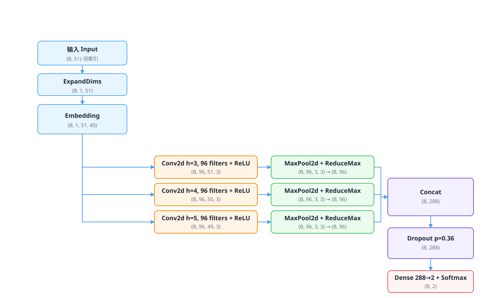

*图：TextCNN 网络结构*

##### ③ 文本向量化（text2vec）

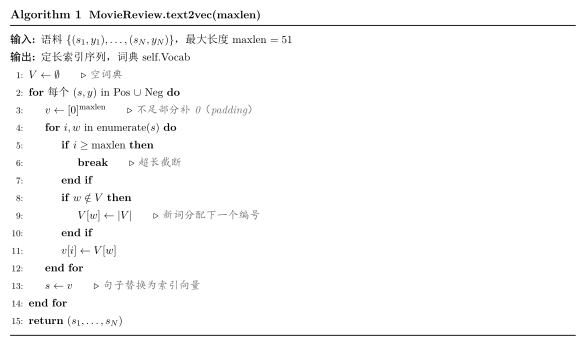

##### ④ 数据集划分（split_dataset）

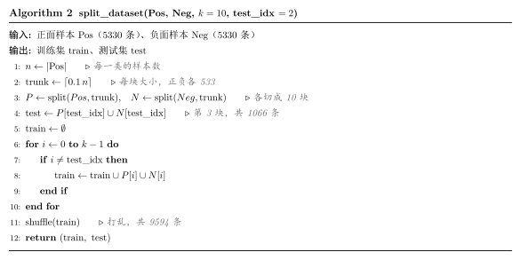

测试集固定为第 3 块，并且保持正负各半，所以评估结果可复现、类别平衡。

##### ⑤ 学习率调度

我们把学习率按总步数分为三段：

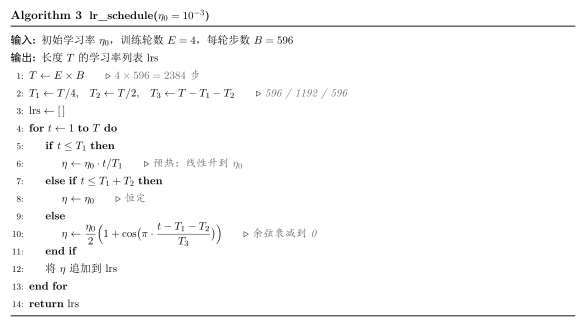

##### ⑥ 在线推理（inference）

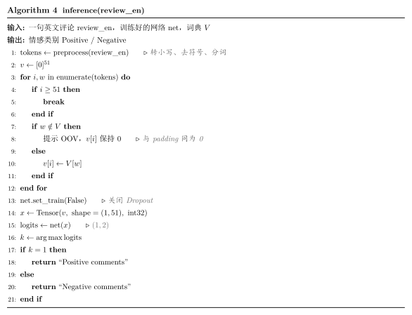

#### （3）程序开发中的重要技术细节

##### ① 使用的主要库与函数

| 函数 / 类 | 来源 | 作用 |
| --- | --- | --- |
| `ms.set_device("Ascend", 0)`、`ms.set_context(mode=GRAPH_MODE)` | `mindspore` | 指定在昇腾 NPU 上运行，并使用静态图模式（先编译整图再执行，速度快） |
| `ds.GeneratorDataset` | `mindspore.dataset` | 把自定义的 Python 可迭代对象（`Generator` 类）包装成 MindSpore 数据集 |
| `dataset.batch(64, drop_remainder=True)` / `dataset.repeat(n)` | `mindspore.dataset` | 组 batch（丢弃不足一个 batch 的尾部）、把数据集重复 n 次 |
| `nn.Embedding(vocab, 40, embedding_table='normal')` | `mindspore.nn` | 词嵌入层，按正态分布初始化 |
| `nn.Conv2d(..., pad_mode="pad", padding=1)` | `mindspore.nn` | 二维卷积，用来实现 n-gram 特征提取 |
| `nn.ReLU`、`nn.MaxPool2d`、`nn.Dropout(p=0.36)`、`nn.Dense(288, 2)` | `mindspore.nn` | 激活、池化、随机失活、全连接分类层 |
| `nn.SequentialCell` | `mindspore.nn` | 把卷积 + ReLU + 池化按顺序组合成一个分支 |
| `ops.ExpandDims`、`ops.ReduceMax`、`ops.Concat` | `mindspore.ops` | 增加通道维、按维度取最大值、拼接三个分支 |
| `nn.SoftmaxCrossEntropyWithLogits(sparse=True)` | `mindspore.nn` | 交叉熵损失（内部先做 Softmax） |
| `nn.Adam(params, learning_rate=list, weight_decay)` | `mindspore.nn` | Adam 优化器；`learning_rate` 传入列表时，第 $t$ 步使用列表第 $t$ 个值 |
| `Model(net, loss_fn, optimizer, metrics={'acc': Accuracy()})` | `mindspore.train` | 高层训练/评估接口，封装了 `train` 和 `eval` |
| `ModelCheckpoint` + `CheckpointConfig` | `mindspore.train.callback` | 每 `epoch_size*batch_num/2` 步保存一次模型，只保留最新 1 个 |
| `LossMonitor`、`TimeMonitor` | `mindspore.train.callback` | 打印每步 loss、每个 epoch 的耗时 |
| `load_checkpoint`、`load_param_into_net` | `mindspore.train.serialization` | 读取 `.ckpt` 文件并把参数加载到网络 |

##### ② 值得注意的实现细节

1. **padding 与真实词共用索引 0**：`text2vec` 中第一个加入词典的词（本实验中为 `the`，因为先读 `.pos` 文件）编号为 0，而 padding 也是 0。因此模型无法区分句尾的补齐位置和单词 `the`；在线推理时 OOV 词也被填成 0，等同于 `the`。
2. **词典包含测试集**：词典是在划分数据集之前、基于全部 10661 条数据建立的，测试集中不会出现 OOV。但只在测试集中出现的词，其嵌入向量从来没有被训练过，仍然是随机初始化的值。

## 3. Experiment Results

### 3.1 Part 1：Word2Vec 词向量训练实验

#### 实验环境与操作步骤

> **1. 安装gensim库**

首先安装 gensim 库。执行 `! pip install gensim` 后，pip 从华为云镜像源下载并成功安装 `gensim-4.4.0`，如图所示。

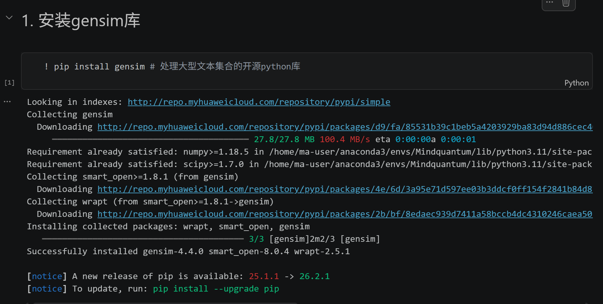

> **2. 导入依赖库**
>
> **3. 定义输入、输出文件路径**

随后导入依赖库并定义输入、输出路径。`cpu_count` 用于获取 CPU 核数并传给 `workers` 实现多进程训练；`Word2Vec` 用于训练词向量；`KeyedVectors` 用于加载离线词向量。语料文件为 `corpus.txt`，输出文件为 `embedding.txt`。

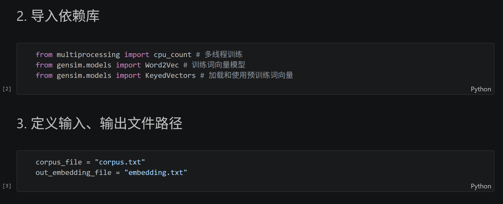

*导入依赖库并定义输入、输出文件路径*

#### 词向量训练与保存

> **4. 查看函数文档**

略

> **5. 词向量训练并保存**
>
> 可以根据函数文档对函数的不同参数进行消融探索，将发现、结论写入实验报告。

训练代码及参数设置如图 3 所示。使用 Skip-gram 模型（`sg=1`），词向量维度为 100，上下文窗口为 5，忽略出现次数少于 5 次的词，并使用全部可用 CPU 并行训练。训练完成后调用 `model.wv.save_word2vec_format(out_embedding_file, binary=False)`，以文本格式保存词向量。

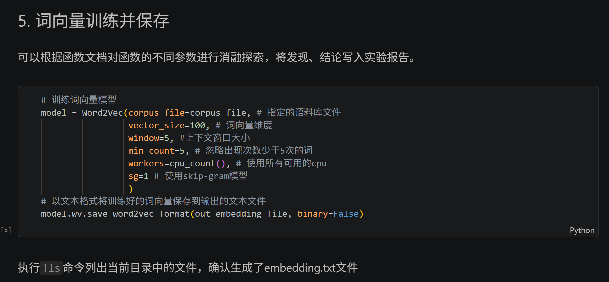

*图 3：Word2Vec 训练参数及保存代码*

**消融实验**

每次只改变一个参数，其余保持默认（100 维、window=5、Skip-gram、min_count=5），固定 epochs=5、seed=42，比较词表规模、训练耗时、四个测试词的首位相似词，以及与 baseline 的 top-10 邻词 Jaccard 重合度。

```python
EXPERIMENTS = [
    ("vector_size=50",  dict(vector_size=50,  window=5,  sg=1, min_count=5)),
    ("vector_size=200", dict(vector_size=200, window=5,  sg=1, min_count=5)),
    ("window=2",        dict(vector_size=100, window=2,  sg=1, min_count=5)),
    ("window=10",       dict(vector_size=100, window=10, sg=1, min_count=5)),
    ("sg=0 (CBOW)",     dict(vector_size=100, window=5,  sg=0, min_count=5)),
    ("min_count=1",     dict(vector_size=100, window=5,  sg=1, min_count=1)),
    ("min_count=20",    dict(vector_size=100, window=5,  sg=1, min_count=20)),
]
results = {}
for name, params in EXPERIMENTS:
    print("\n" + "=" * 60)
    print(f"训练配置: {name}  {params}")
    t0 = time.perf_counter()
    m = Word2Vec(corpus_file=corpus_file, workers=cpu_count(),
                 epochs=5, seed=42, **params)   # epochs 固定，保证公平比较
    elapsed = time.perf_counter() - t0
    results[name] = {
        "params": params,
        "vocab": len(m.wv),
        "time": elapsed,
        "neighbors": {w: get_neighbors(m.wv, w, EVAL_TOPN) for w in probe_words},
    }
    print(f"词表大小: {len(m.wv)}  训练耗时: {elapsed:.1f}s")
    for w in probe_words:
        res = results[name]["neighbors"][w]
        print(f"  {w}: {[(x, round(s, 4)) for x, s in res[:PRINT_TOPN]]}")
```

输出为：

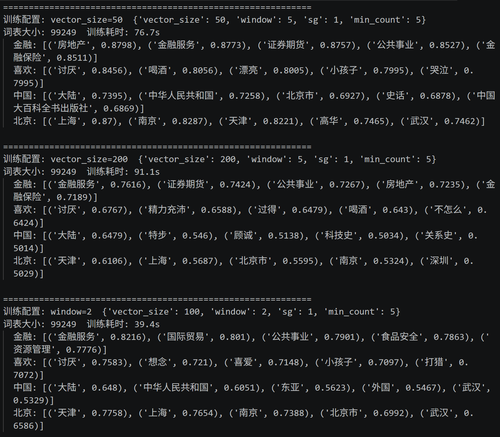 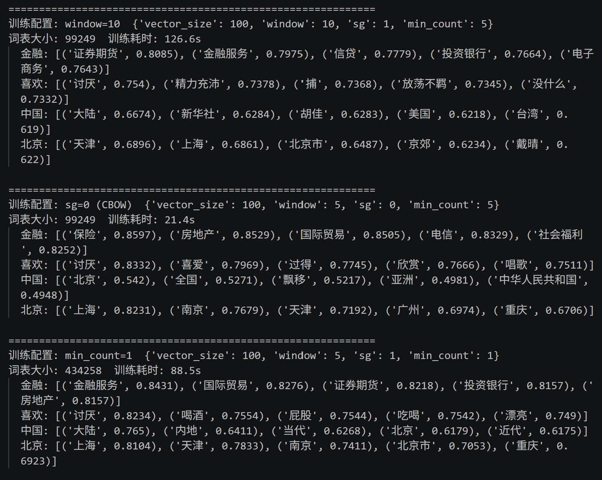 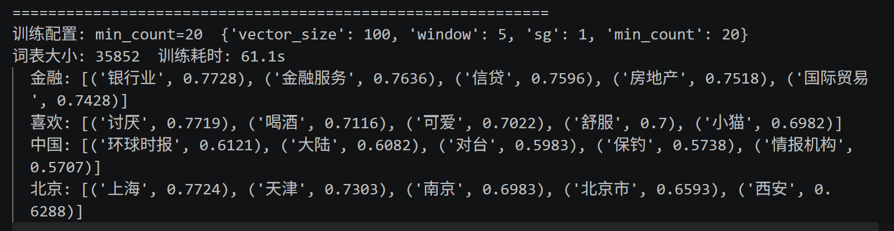

可以看出：

- **维度**：50 维已能召回正确的领域词和城市词，200 维更慢且噪声更多；100 维较均衡。
- **窗口**：`window=2` 最快，偏向局部搭配和近义词；`window=10` 最慢，偏向主题共现但噪声更大；5 较折中。
- **模型**：CBOW 最快，近义词结果更直观；Skip-gram 对低频词更敏感。
- **词频阈值**：`min_count=1` 词表扩大约 4.4 倍并引入长尾噪声；`min_count=20` 词表缩至 36%，会丢失部分词；5 较平衡。

> 执行`!ls`命令列出当前目录中的文件，确认生成了embedding.txt文件

略

#### 加载离线词向量

> **6. 加载离线词向量**
>
> 从保存的文件中加载词向量模型
>
> 获取单个词的词向量

使用 `KeyedVectors.load_word2vec_format("embedding.txt")` 从保存的文件中重新加载词向量。随后通过 `word2vec_model['上海']` 获取单词“上海”的词向量，结果为一个 100 维的 `numpy.ndarray`，如图所示。

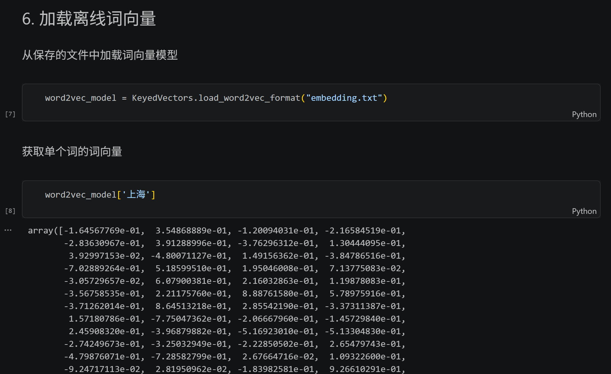

#### 相似词测试与结果分析

> **7. 相似度测试**
>
> 可以在此处进行对不同词语的实验和探索，将发现和结论写进实验报告。

使用 `most_similar(word)` 对 `['金融', '喜欢', '中国', '北京']` 四个词分别检索相似词，结果如图 5 所示。`most_similar` 默认返回余弦相似度最高的 10 个词，截图中可见每个词的前 4 个结果。

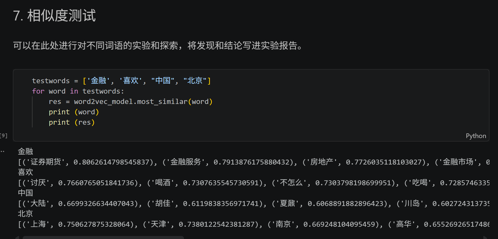

*图 5：四个测试词的相似词及余弦相似度*

**拓展探索**

（1）分主题相似词

```python
def show_similar(word, topn=5):
    res = word2vec_model.most_similar(word, topn=topn)
    print(f"{word}: " + ", ".join(f"{w}({s:.3f})" for w, s in res))

groups = {
    "城市":       ["北京", "上海", "广州", "深圳", "天津"],
    "国家/地区":  ["中国", "美国", "日本", "法国", "德国"],
    "学科":       ["数学", "物理", "化学", "生物", "历史"],
    "情感/评价":  ["喜欢", "讨厌", "高兴", "悲伤", "优秀"],
}
for group, words in groups.items():
    print("\n" + "=" * 60)
    print(f"【{group}】")
    for w in words:
        show_similar(w, topn=5)
```

**输出**

```text
============================================================
【城市】
北京: 天津(0.761), 上海(0.718), 南京(0.654), 高华(0.643), 北京市(0.639)
上海: 重庆(0.740), 北京(0.718), 深圳(0.705), 淘宝(0.689), 南京(0.688)
广州: 深圳(0.740), 杭州(0.740), 武汉(0.723), 广东(0.715), 南昌(0.699)
深圳: 上海浦东(0.758), 富力(0.755), 东莞(0.751), 卓尔(0.748), 佳兆业(0.747)
天津: 北京(0.761), 青岛(0.732), 大连(0.710), 烟台(0.696), 权健(0.691)

============================================================
【国家/地区】
中国: 大陆(0.724), 中国邮政(0.614), 中华人民共和国(0.607), 环球时报(0.600), 中新社(0.585)
美国: 加拿大(0.700), 英国(0.678), 华盛顿(0.644), 墨西哥(0.629), 纽约(0.624)
日本: 佐藤(0.711), 江户(0.700), 井上(0.686), 漫画家(0.658), 津田(0.656)
法国: 比利时(0.842), 意大利(0.824), 奥地利(0.816), 荷兰(0.794), 夏尔(0.789)
德国: 奥地利(0.853), 瑞士(0.796), 比利时(0.787), 瑞典(0.774), 意大利(0.774)

============================================================
【学科】
数学: 微积分(0.787), 微积分学(0.785), 数理逻辑(0.784), 几何学(0.773), 解析数论(0.772)
物理: 物理学(0.810), 凝聚态(0.784), 高能物理(0.781), 天体力学(0.772), 电学(0.772)
化学: 有机化学(0.793), 无机化学(0.783), 物理化学(0.764), 电化学(0.763), 分析化学(0.753)
生物: 原核(0.802), 真核(0.789), 微生物(0.789), 植物(0.777), 非生物(0.769)
历史: 古代史(0.685), 史前史(0.681), 起源地(0.677), 军事史(0.674), 发展史(0.674)

============================================================
【情感/评价】
喜欢: 讨厌(0.742), 喝酒(0.724), 不怎么(0.724), 精力充沛(0.714), 吃喝(0.703)
讨厌: 责骂(0.858), 和蔼可亲(0.850), 脾气(0.847), 很会(0.845), 欺负(0.841)
高兴: 这事(0.823), 听后(0.817), 怎么办(0.810), 难过(0.806), 柳儿(0.803)
悲伤: 面容(0.833), 迷恋(0.825), 难过(0.823), 心事(0.819), 樵夫(0.812)
优秀: 一等奖(0.701), 模范城(0.699), 获此(0.699), 卓越(0.698), 十佳(0.695)
```

（2）词对余弦相似度

```python
pairs = [
    ("北京", "上海"), ("北京", "中国"), ("中国", "美国"),
    ("喜欢", "讨厌"), ("喜欢", "高兴"), ("数学", "物理"),
    ("数学", "历史"), ("老师", "教师"),
]
for a, b in pairs:
    print(f"  sim({a}, {b}) = {word2vec_model.similarity(a, b):.4f}")
```

**输出**

```text
【词对余弦相似度】
  sim(北京, 上海) = 0.7176
  sim(北京, 中国) = 0.5488
  sim(中国, 美国) = 0.4037
  sim(喜欢, 讨厌) = 0.7421
  sim(喜欢, 高兴) = 0.6224
  sim(数学, 物理) = 0.6710
  sim(数学, 历史) = 0.3907
  sim(老师, 教师) = 0.6522
```

`sim(数学, 物理)=0.6710` 远高于 `sim(数学, 历史)=0.3907`，符合学科相近性。`sim(喜欢, 讨厌)=0.7421` 高于 `sim(喜欢, 高兴)=0.6224`，说明反义词在分布表示中可能比同类词更接近。

（3）词向量类比

**代码**

```python
analogies = [
    (["日本", "北京"], ["中国"]),   # 中国:北京 = 日本:?  -> 期望 东京
    (["中国", "东京"], ["日本"]),   # 日本:东京 = 中国:?  -> 期望 北京
    (["女人", "国王"], ["男人"]),   # 男人:国王 = 女人:?  -> 期望 女王
]
for pos, neg in analogies:
    res = word2vec_model.most_similar(positive=pos, negative=neg, topn=5)
    print(f"  {pos} - {neg}: " + ", ".join(f"{w}({s:.3f})" for w, s in res))
```

**输出**

```text
【词向量类比】
  ['日本', '北京'] - ['中国']: 东京(0.632), 神户(0.545), 加藤(0.542), 京都(0.541), 村上(0.538)
  ['中国', '东京'] - ['日本']: 中关村(0.590), 北京(0.580), 国家大剧院(0.573), 科技报(0.572), 华西都市报(0.567)
  ['女人', '国王'] - ['男人']: 七世(0.664), 王后(0.653), 卡佩(0.652), 查理一世(0.643), 六世(0.642)
```

- “日本 + 北京 − 中国”首位返回“东京”（0.632），正确捕捉了“首都”关系。
- 其它两项，“北京”与“王后”成功出现在了前几位中，但也出现了一些噪音。类比只能保证语义方向大致正确，受语料共现和词频影响较大。

（4）找不同类

**代码**

```python
for words in [["北京", "上海", "天津", "苹果"],
              ["数学", "物理", "化学", "诗歌"],
              ["喜欢", "讨厌", "高兴", "桌子"]]:
    print(f"  {words} -> {word2vec_model.doesnt_match(words)}")
```

**输出**

```text
【找不同类】
  ['北京', '上海', '天津', '苹果'] -> 苹果
  ['数学', '物理', '化学', '诗歌'] -> 诗歌
  ['喜欢', '讨厌', '高兴', '桌子'] -> 桌子
```

三组全部判断正确：苹果与城市、诗歌与理科、桌子与情感词均不属于同一语义类别。这说明词向量在粗粒度语义类别上具有较好的可区分性，能够支持简单的语义筛选任务。

### 3.2 Part 2：TextCNN 情感分析实验

#### 实验环境与操作步骤

> **0. 环境配置与准备**

略

> **1. 导入依赖库**
>
> **2. 安装 easydict 库**

导入 numpy、pandas 等基础库以及 MindSpore 的 `dataset`、`nn`、`ops`、`Model`、回调函数等模块。`easydict` 在镜像中已经安装（1.13）。

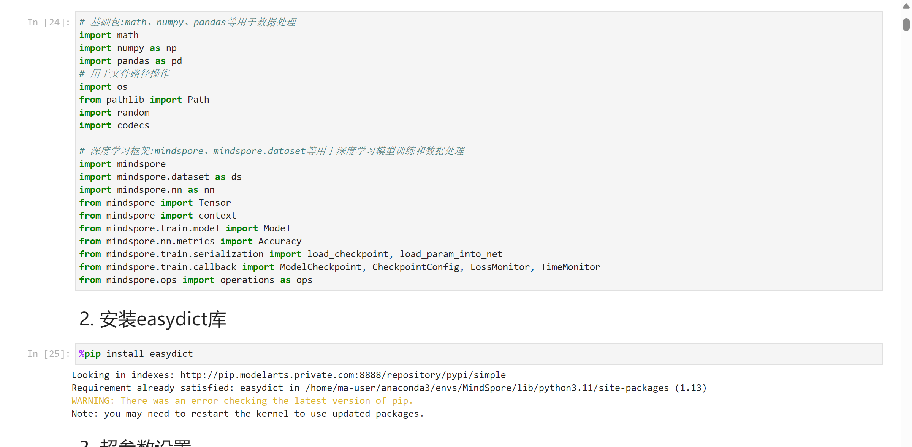

> **3. 超参数设置**

超参数与手册一致：`batch_size=64`、`epoch_size=4`、`weight_decay=3e-5`、`word_len=51`、`vec_length=40`。

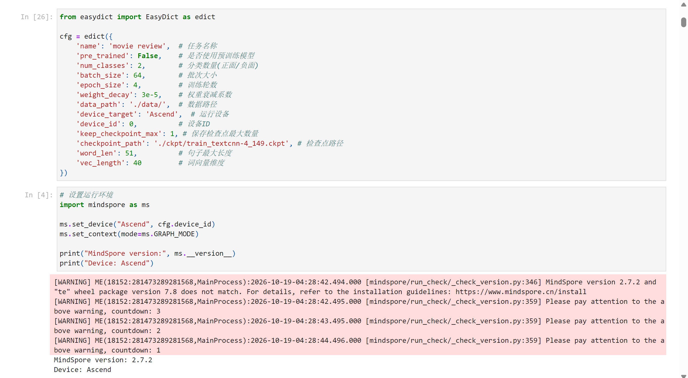

#### 数据预处理

> **4.1 原始数据预览**

正、负面影评各打印前 5 条。数据是已经小写、并且用空格把标点分开的英文短句，例如负面的 “simplistic , silly and tedious .”，正面的 “effective but too-tepid biopic”。可以看到有些正面句子本身就带有负面词（如 “too-tepid”），说明这个数据集并不完全依靠单个词就能判断。

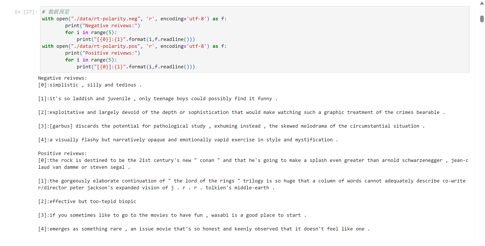

> **4.2 定义数据预处理函数**
>
> **4.3 调用函数对原始数据进行预处理**
>
> **4.4 打印预处理结束的数据**

补全 `text2vec` 后，生成训练数据集并打印第一个 batch。

句子有 23 个词，后面全部是 padding 0。注意第 1 个和第 15 个位置也是 0，它们对应的是单词 `the`（词典中第一个词），和 padding 用的是同一个编号。

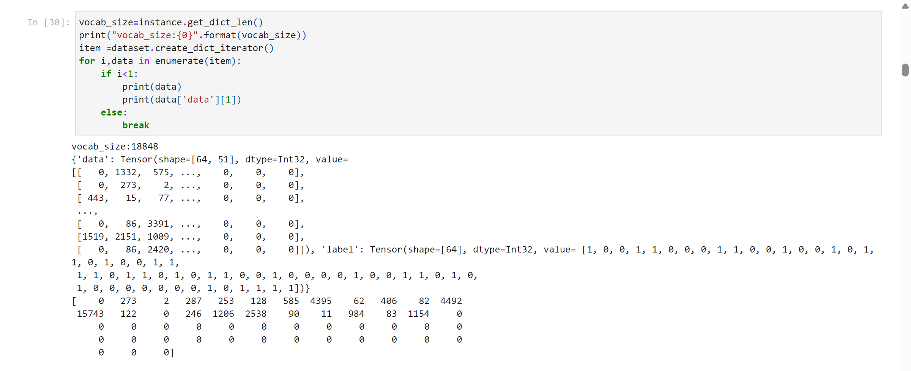

#### 模型训练

> **5.1 训练参数设置**
>
> 可以在此处以及 5.1、5.2 处进行不同超参组合的消融和探索，将发现和结论写入实验报告。

`batch_num = 596`（每遍训练集 149 个 batch × repeat 4），总步数 $4\times596=2384$。学习率分为三段：预热 596 步、恒定 1192 步、余弦衰减 596 步，打印结果的开头是 `0.0, 1.68e-06, 3.36e-06, ...`，线性增长。

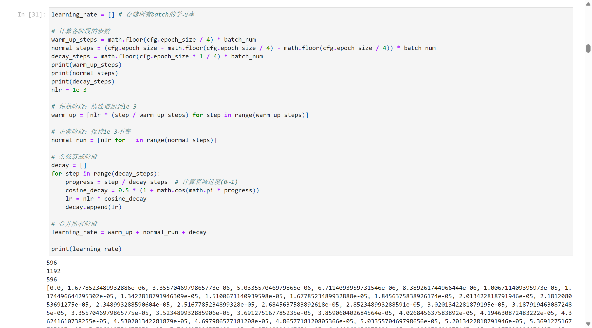

> **5.2 神经网络设置**
>
> **5.3 模型实例化**

`print(net)` 输出的网络结构如下：嵌入层 `(18848, 40)`；三个分支的卷积核分别为 `(3, 40)`、`(4, 40)`、`(5, 40)`，各 96 个通道；池化核分别为 `(49, 1)`、`(48, 1)`、`(47, 1)`；最后接 `Dropout(p=0.36)` 和 `Dense(288, 2)`。

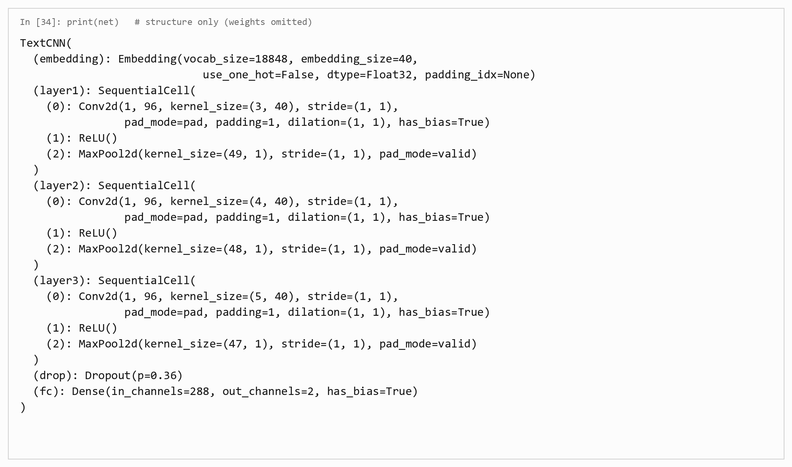

> **5.4 定义损失函数和优化器**
>
> **5.5 模型封装**
>
> **5.6 回调函数**
>
> **5.7 开始训练**

使用 Adam + 交叉熵进行训练，并用 `LossMonitor`、`TimeMonitor` 和 `ModelCheckpoint` 监控与保存。训练日志如图 12 所示。

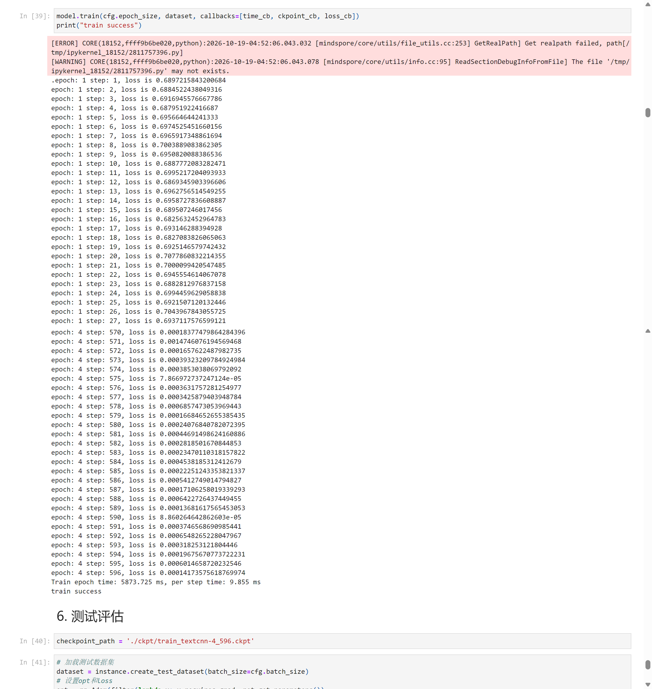

可以看出：

- 第 1 个 epoch 的前半段处于预热阶段，学习率很小，loss 一直在 $\ln2\approx0.693$ 附近（相当于随机猜）；学习率升上来之后 loss 快速下降，到第 1 个 epoch 末降到 0.23。
- 从第 2 个 epoch 开始，loss 很快降到 0.01 以下，第 4 个 epoch 只有 $10^{-4}$ 量级，说明模型已经几乎完全“记住”了训练集。
- 第 1 个 epoch 多花了约 2 秒，是图模式编译的开销；之后每步约 10 ms，整个训练只用了约 26 秒，体现了 TextCNN 计算量小、易并行的优点。

**消融实验**

训练轮数方面，我们对比 baseline（16 个 pass）和 `passes=4`。

原 notebook 只在训练结束时评估一次，看不出过拟合是从什么时候开始的。我们改为**每遍历一次训练集（1 个 pass）就在训练集和测试集上各评估一次**，总训练量与原 notebook 相同（16 个 pass，2384 步）。固定随机种子为 42：

| 配置 | 改动 | 想验证的问题 |
| --- | --- | --- |
| baseline | 训练 16 个 pass（与 notebook 相同） | 过拟合从何时开始 |
| passes=4 | 只训练 4 个 pass | 训练 16 遍是否过多 |

```python
def run_experiment(name, passes=16, seed=42):
    ...
    for p in range(1, passes + 1):
        model_x.train(1, train_ds, dataset_sink_mode=False)
        tr = model_x.eval(train_ds, dataset_sink_mode=False)
        te = model_x.eval(test_ds, dataset_sink_mode=False)
        ...
```

**输出**

| config | final_test_acc | best_test_acc | best_pass | final_train_acc | time_s |
| --- | --- | --- | --- | --- | --- |
| baseline | 0.7490 | 0.7725 | 4 | 0.9999 | 31.4 |
| passes=4 | 0.7734 | 0.7734 | 4 | 0.9885 | 8.4 |

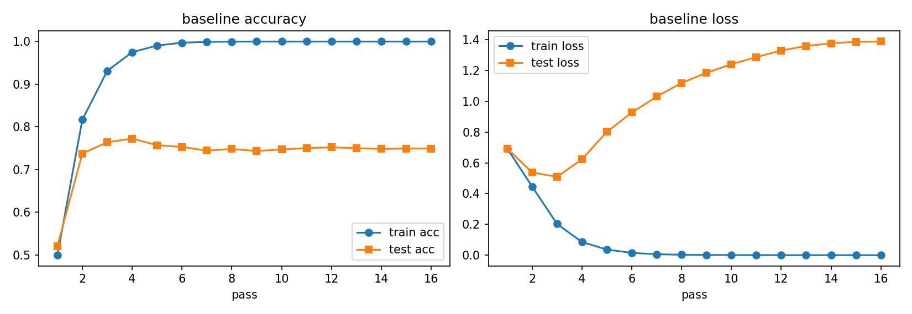

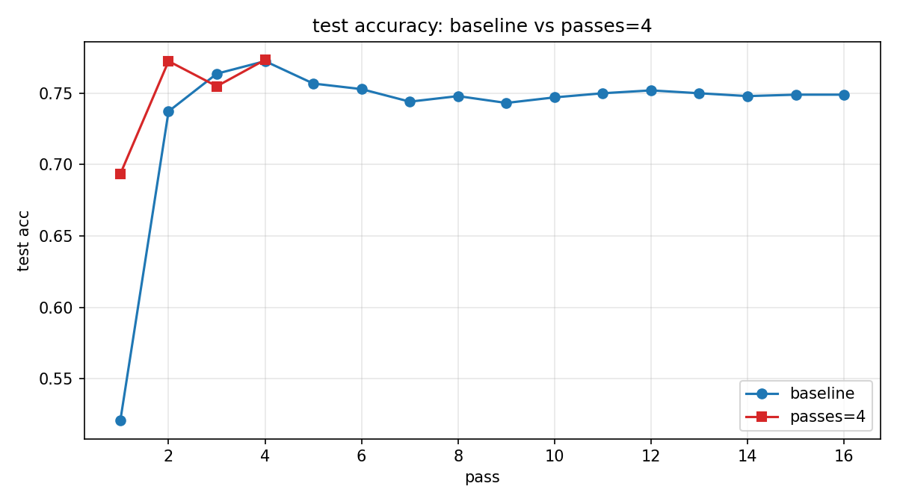

可以看出：

- **过拟合时间点**：baseline 的测试准确率在第 4 个 pass 达到峰值 0.7725（此时 train_acc=0.9749），之后开始下降；到第 9 个 pass 时 train_acc 已经到 0.9999，而 test_acc 降到 0.7432，test_loss 从 0.6225 一路升到 1.3878。到第 16 个 pass，final_test_acc 只剩 0.7490。也就是说，模型在第 4 个 pass 之后就开始过拟合，到第 9 个 pass 已经非常明显。`passes=4` 只用 8.4 秒就得到 0.7734，和 16 个 pass 的最好结果（0.7725）基本一样，说明继续训练 4 倍时间并没有带来收益，early stopping 比“多训几轮”更有效。

#### 测试评估

> **6. 测试评估**

加载 `./ckpt/train_textcnn-4_596.ckpt`，在测试集上评估，准确率为 **77.44%**。

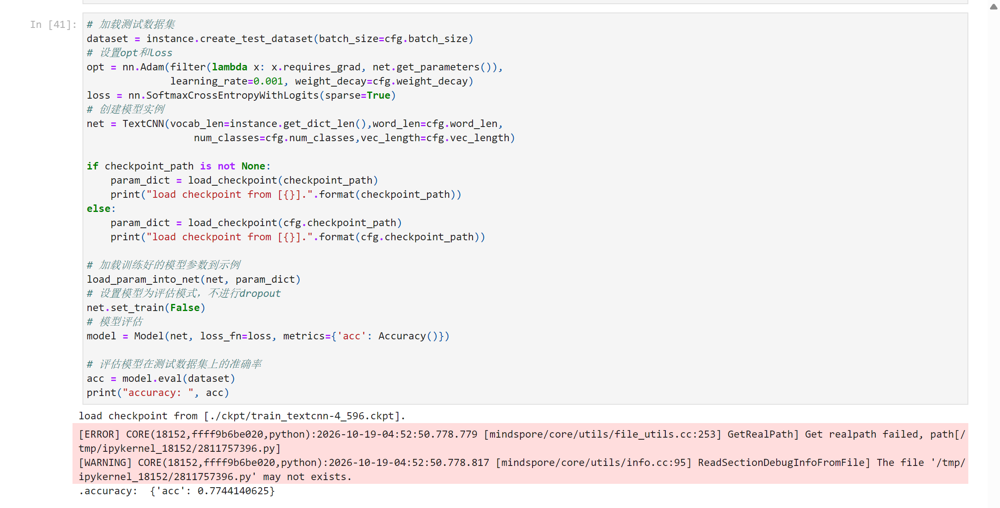

训练 loss 接近 0（训练集准确率接近 100%），测试准确率只有 77.4%，说明模型**明显过拟合**。作为参考，Kim (2014) 论文中 CNN-rand 在 MR 数据集上的 10 折交叉验证准确率为 76.1%，我们的结果与之相当。数据集只有约 1 万条短句，而模型的嵌入层就有 $18848\times40\approx75$ 万个参数，参数量远大于样本量，过拟合是可以预期的。

#### 在线测试与 case 分析

> **7. 在线测试**
>
> 在这里对特定的文本句子进行测试，并且分析你训练的模型在哪些 case 上是成功的，在哪些 case 上容易失败，如果可以的话尝试探索/分析原因

补全 `inference` 后，输入 `"the movie is good"`，模型输出 `Positive comments`，判断正确。

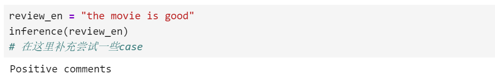

为了系统地分析模型在哪些情况下成功、在哪些情况下失败，我们首先定义一系列辅助函数：

```python
def tokenize(sentence):
    s = sentence.lower().strip()
    for a, c in CLEAN:
        s = s.replace(a, c)
    return [w for w in s.split(' ') if w]

def encode(tokens, vocab, word_len=cfg.word_len):
    vec, oov = [0] * word_len, []
    for i, w in enumerate(tokens[:word_len]):
        if w in vocab:
            vec[i] = vocab[w]
        else:
            oov.append(w)
    return vec, oov

def predict_proba(net_, sentences, vocab, bs=64):
    """返回每句 P(positive) 以及 OOV 词"""
    net_.set_train(False)
    enc = [encode(tokenize(s), vocab) for s in sentences]
    x = np.array([e[0] for e in enc], dtype=np.int32)
    probs = []
    for i in range(0, len(x), bs):
        chunk = x[i:i + bs]
        n = len(chunk)
        if n < bs:
            chunk = np.vstack([chunk, np.zeros((bs - n, x.shape[1]), np.int32)])
        logits = net_(Tensor(chunk)).asnumpy()[:n]
        e = np.exp(logits - logits.max(1, keepdims=True))
        probs.append((e / e.sum(1, keepdims=True))[:, 1])
    return np.concatenate(probs), [e[1] for e in enc]
```

我们设计了 6 类共 18 个测试句子，输出 $P(\text{pos})$ 和 OOV 词：

```python
CASES = [  # (类别, 句子, 期望标签 1=pos 0=neg)
    ("基础", "a wonderful , moving and beautifully acted film", 1),
    ("基础", "boring", 0),
    ("否定", "not good", 0),
    ("否定", "not bad", 1),
    ("转折", "the acting is great but the plot is boring and predictable", 0),
    ("转折", "the plot is boring and predictable but the acting is great", 1),
    ("讽刺", "what a great way to waste two hours", 0),
    ("格式/OOV", "Absolutely AMAZING!!!", 1),
    ("稀释", "the film follows a family who move to ... and the story is a bit dull", 0),
    ...
]
probs, oovs = predict_proba(net, [c[1] for c in CASES], instance.Vocab)
```

**输出**

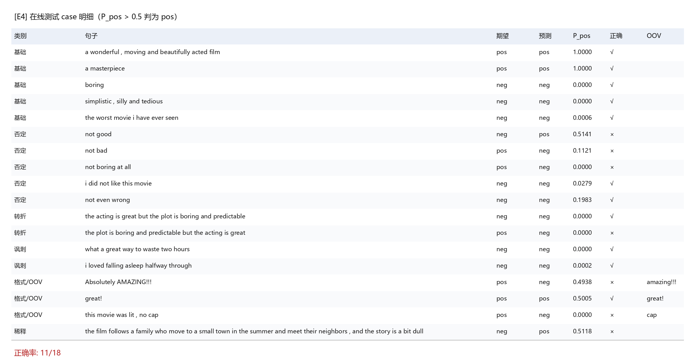

为了解释上面的现象，我们统计了关键词在训练数据正/负句子中的出现次数：

| word | #pos句 | #neg句 | pos占比 |
| --- | --- | --- | --- |
| good | 210 | 183 | 0.534 |
| great | 104 | 55 | 0.654 |
| bad | 33 | 186 | 0.151 |
| not | 355 | 417 | 0.460 |
| boring | 3 | 51 | 0.056 |
| wrong | 9 | 28 | 0.243 |
| waste | 2 | 24 | 0.077 |
| loved | 13 | 4 | 0.765 |
| but | 770 | 843 | 0.477 |
| masterpiece | 23 | 4 | 0.852 |
| dull | 6 | 73 | 0.076 |
| predictable | 23 | 48 | 0.324 |
| asleep | 1 | 2 | 0.333 |
| amazing | 17 | 3 | 0.850 |

并用**遮挡分析**（逐个删掉一个词，看 $P(\text{pos})$ 下降多少）找出模型判断时依赖的词：

```python
def occlusion(net_, sentence, vocab):
    toks = tokenize(sentence)
    variants = [" ".join(toks)] + [" ".join(toks[:i] + toks[i + 1:]) for i in range(len(toks))]
    p, _ = predict_proba(net_, variants, vocab)
    print(f"\n句子: {sentence}\nP(pos) = {p[0]:.4f}")
    for i, w in enumerate(toks):
        d = p[0] - p[i + 1]
        print(f"  {w:>14s}  删除后 P(pos)={p[i + 1]:.4f}  贡献={d:+.4f}  " + "#" * int(abs(d) * 40))
```

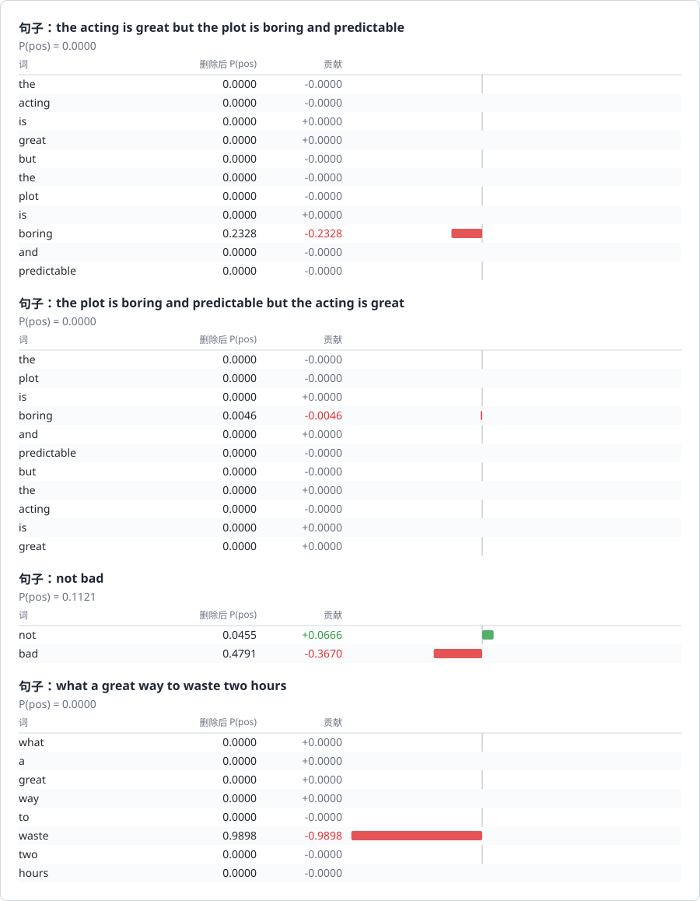

**分析**：

- **成功的 case**：情感词明确的句子（如 “a masterpiece”、“boring”、“simplistic , silly and tedious”）判断正确且置信度高。这些词在训练集中的正负分布非常不均衡（见上表），例如 `boring` 在 51 条负面句和 3 条正面句中出现，模型很容易学到。
- **否定**：5 条里错了 3 条。“not good” 被判成 pos（P=0.5141），“not bad” 被判成 neg（P=0.1121），“not boring at all” 也被判成 neg（P=0.0000）。遮挡分析显示，去掉 `bad` 后 “not bad” 的 P(pos) 从 0.1121 升到 0.4791，说明句子的极性几乎完全由 `bad` 决定；`not` 只带来约 +0.067 的修正，远不足以翻转形容词的极性。
- **转折**：两个方向相反的句子 P(pos) 都是 0.0000，说明模型完全没有利用 `but` 前后的顺序。遮挡分析中删掉 `boring` 后 P(pos) 才从 0.0000 升到 0.2328（另一个方向只到 0.0046），而删掉 `great` 的贡献是 0.0000，进一步证明判断只依赖 `boring`，`great`/`but` 没有起作用。训练数据里 `but` 在正负句中分别出现 770/843 次，本身也不带极性。
- **讽刺**：两句都判对了，但遮挡分析显示 “what a great way to waste two hours” 的 P(pos) 完全由 `waste` 决定（删掉 `waste` 后 P(pos) 从 0.0000 升到 0.9898，`great` 的贡献为 0）。也就是说模型并不是理解了讽刺，而是抓住了 `waste` 这个强负面词。
- **格式/OOV**：`preprocess` 没有去掉 `!`，所以 `amazing!!!`、`great!` 会被当作 OOV，编码成 0（也就是 `the`）。`great!` 的 P=0.5005 恰好比 0.5 高一点，是一个“蒙对”的边界情况。`Absolutely AMAZING!!!` 只剩 `absolutely` 可用，P=0.4938，刚好低于阈值。`this movie was lit , no cap` 里的 `lit`/`cap` 都是 OOV，模型只看到中性词，P=0.0000。可见模型对大小写、标点和网络用语都不鲁棒。
- **稀释**：这个长句只有一个明确的负面词 `dull`，但前面堆了很多中性/轻微正向的词（family、summer、neighbors、story）。最大池化会挑出最强的那个 n-gram，结果 P=0.5118，被误判为 pos。句子越长、情感词越靠后、中性上下文越多，单个情感词的信号就越容易被稀释。

## References

由 华为技术有限公司 出品的：

I. 《自然语言处理》词向量实验手册.
II. 《自然语言处理》文本分类实验手册.

以及：

1. Mikolov, T., Chen, K., Corrado, G., & Dean, J. (2013). *Efficient Estimation of Word Representations in Vector Space*. arXiv:1301.3781.
2. Mikolov, T., Sutskever, I., Chen, K., Corrado, G., & Dean, J. (2013). *Distributed Representations of Words and Phrases and their Compositionality*. In Advances in Neural Information Processing Systems 26 (NIPS 2013), pp. 3111–3119.
3. Goldberg, Y., & Levy, O. (2014). *word2vec Explained: Deriving Mikolov et al.'s Negative-Sampling Word-Embedding Method*. arXiv:1402.3722.
4. Kim, Y. (2014). *Convolutional Neural Networks for Sentence Classification*. In Proceedings of EMNLP 2014, pp. 1746–1751.
5. Řehůřek, R., & Sojka, P. (2010). *Software Framework for Topic Modelling with Large Corpora*. In Proceedings of the LREC 2010 Workshop on New Challenges for NLP Frameworks, pp. 45–50.
6. Harris, Z. S. (1954). *Distributional Structure*. Word, 10(2–3), 146–162.
7. Firth, J. R. (1957). *A Synopsis of Linguistic Theory, 1930–1955*. In Studies in Linguistic Analysis, pp. 1–32. Oxford: Philological Society.
8. Jurafsky, D., & Martin, J. H. *Speech and Language Processing* (3rd ed. draft). Stanford University. https://web.stanford.edu/~jurafsky/slp3/
9. MindSpore. *MindSpore Documentation*. https://www.mindspore.cn/docs/
