import Excalidraw from "@md-comp/Excalidraw.vue";
import pipelineUrl from "./fig_2_2_pipeline.excalidraw?url";
import transformerUrl from "./fig_2_3_transformer.excalidraw?url";

# 实验二：基于 Transformer 的机器翻译

## 1. Project Introduction

### （1）实验简介

本实验使用 MindSpore 实现并训练一个 Transformer（base 配置）**英译中**翻译模型，包括以下四个环节：

1. **数据准备**：读取 23,610 条已用空格分好词的英中句对，英文按词、中文按字切分。查共享词表把 token 转成 id，加上 `<s>`/`</s>` 标记，补齐到 40 位，写成 MindRecord 文件。按 8:2 随机切分训练集和测试集。
2. **模型构建**：6 层 Encoder 加 6 层 Decoder，`d_model=512`、8 个注意力头、FFN 维度 2048，使用正弦位置编码、Pre-LN 残差结构，输入词向量与输出投影共享权重。
3. **模型训练**：训练时用 Teacher Forcing，损失为带 Label Smoothing 的交叉熵，优化器为 Adam，学习率先 warmup 再按反平方根衰减，并做梯度范数裁剪，共训练 15 个 epoch。
4. **模型推理**：用 Beam Search 自回归解码，在测试集上输出译文。


### （2）开发环境及系统运行要求

- 开发环境：ModelArts Ascend Notebook 环境。
- 实际使用的具体环境：
  - 规格 `1 * Ascend Snt9 | 24 vCPUs | 96 GB`；
  - 公共镜像 `mindspore_2.7.2-cann_8.5.2-py_3.11-hce_2.0.2512-aarch64-snt9b`

## 2. Technical Details

### 理论知识

> （1）工程实践当中所用到的理论知识阐述

**（1）神经机器翻译与 Encoder-Decoder 框架**

机器翻译可以看成一个条件语言模型：给定源语言句子 $x=(x_1,\dots,x_S)$，模型要估计目标句 $y=(y_1,\dots,y_T)$ 的条件概率，并按自回归方式分解：

$$
P(y\mid x)=\prod_{t=1}^{T}P(y_t\mid y_{<t},x)
$$

Encoder 把源句编码成一组上下文向量 $H=\mathrm{Enc}(x)\in\mathbb R^{S\times d}$。Decoder 每一步读入已生成的前缀 $y_{<t}$，同时关注 $H$，输出下一个词在词表上的分布。实验手册第 2 章的 Seq2Seq 用 GRU 逐步传递隐状态，计算无法在时间维上并行，长距离依赖也要经过很多步才能传到。Transformer 把循环结构全部换成注意力，任意两个位置之间的路径长度都是 $O(1)$，训练时整个序列可以并行计算。

**（2）缩放点积注意力与多头注意力**

$$
\mathrm{Attention}(Q,K,V)=\mathrm{softmax}\!\left(\frac{QK^\top}{\sqrt{d_k}}+M\right)V
$$

其中 $M$ 是加性掩码：允许关注的位置为 $0$，屏蔽的位置为一个很大的负数（代码里是 $-10000$）。除以 $\sqrt{d_k}$ 是为了防止维度较大时点积数值过大，使 softmax 落入梯度接近 0 的饱和区。

多头注意力先用 $W^Q,W^K,W^V\in\mathbb R^{d\times d}$ 做线性映射，再把结果在特征维上切成 $h$ 份，每个头的维度 $d_k=d/h$。各头独立计算注意力后拼接，最后经过 $W^O$ 输出：

$$
\begin{aligned}
\mathrm{MHA}(X,Y)&=\mathrm{Concat}(\mathrm{head}_1,\dots,\mathrm{head}_h)W^O,\\
\mathrm{head}_i&=\mathrm{Attention}(XW^Q_i,YW^K_i,YW^V_i)
\end{aligned}
$$

模型中有三种注意力：

| 类型 | 位置 | Q 来源 | K/V 来源 | 掩码 |
|---|---|---|---|---|
| Encoder 自注意力 | Encoder 每层 | 源句 | 源句 | 源句 padding 掩码 $m^{src}(m^{src})^\top$ |
| Decoder 掩码自注意力 | Decoder 每层第 1 个子层 | 目标前缀 | 目标前缀 | 目标 padding 掩码 ⊙ 下三角因果掩码 |
| Encoder-Decoder 交叉注意力 | Decoder 每层第 2 个子层 | 目标前缀 | Encoder 输出 | 理论上每个目标位置都可以看到所有有效的源位置：$\mathbf 1_T (m^{src})^\top$ |

**（3）位置编码、残差与层归一化**

注意力本身不区分输入顺序，所以要在词向量上加入位置信息。本实现用固定的正弦位置编码（`position_encoding`）：前 $d/2$ 维为 $\sin(pos\cdot\omega_i)$，后 $d/2$ 维为 $\cos(pos\cdot\omega_i)$，$\omega_i=10000^{-i/(d/2-1)}$。词向量加位置编码之前先乘以 $\sqrt{d}$（`EmbeddingPostprocessor`）。

每个子层都按 **Pre-LN** 方式组织：$x\leftarrow x+\mathrm{Dropout}(\mathrm{Sublayer}(\mathrm{LN}(x)))$。对应代码中的 `LayerPreprocess`（先做 LayerNorm）和 `LayerPostprocess`（Dropout 后加残差）。Encoder 和 Decoder 的输出端各有一个额外的 LayerNorm。与原论文的 Post-LN 相比，Pre-LN 的梯度更稳定，对 warmup 长度不那么敏感。

前馈网络对每个位置单独作用：$\mathrm{FFN}(x)=W_2\,\mathrm{ReLU}(W_1x+b_1)+b_2$，维度变化为 $512\to2048\to512$。

**（4）权重共享与输出层**

源语言、目标语言和输出投影共用同一个 $V\times d$ 的词向量矩阵 $E$（`tfm_embedding_lookup.embedding_table`）。输出层计算 $\log\mathrm{softmax}(hE^\top)$（`PredLogProbs`）。本实验的中英文 token 都在同一个 10,067 大小的词表里，共享后参数量减少约 $2\times5.15$M，也让中英 token 处在同一个向量空间中。

**（5）训练目标：Teacher Forcing 与 Label Smoothing**

训练时把整条真实目标句右移一位作为 Decoder 输入（`<s> y_1 … y_{T-1}`），标签为 `y_1 … y_T </s>`，配合因果掩码，一次前向就能并行算出所有位置的损失，这就是 Teacher Forcing。推理时 Decoder 只能读到自己生成的前缀，训练和推理的输入分布因此不同，称为 **exposure bias**，前面一步出错会影响后面所有步。

损失函数是带 Label Smoothing（$\varepsilon=0.1$）的交叉熵：目标词的概率设为 $1-\varepsilon=0.9$，其余 $V-1$ 个词平分 $\varepsilon$。padding 位置用 `label_weights` 屏蔽：

$$
\mathcal L=-\frac{\sum_{b,t}w_{b,t}\sum_{v}q_{b,t,v}\log p_{b,t,v}}{\sum_{b,t}w_{b,t}},\qquad q_{b,t,v}=\begin{cases}0.9 & v=y_{b,t}\\ 0.1/(V-1) & \text{otherwise}\end{cases}
$$

因此，即使模型的预测与 $q$ 完全一致，损失也不会降到 0，下界约为 $q$ 的熵 $H(q)\approx0.33+0.1\ln(10066/0.1)\approx1.48$。看训练曲线时需要注意这一点。

**（6）学习率调度：Warmup + 反平方根衰减**

`create_dynamic_lr` 用 `constant*rsqrt_hidden*linear_warmup*rsqrt_decay` 组合出学习率（$s$ 为步数，$w$ 为 warmup 步数，$s_d$ 为开始衰减的步数）：

$$
\eta(s)=\eta_0\cdot d^{-0.5}\cdot\min\!\left(1,\frac{s}{w}\right)\cdot\max(s-s_d+w,\ w)^{-0.5}
$$

当 $w<s<s_d$ 时，学习率保持上一步的值不变。notebook 中的设置为 $\eta_0=1.0,\ w=800,\ s_d=1200$，学习率从 0 线性升到峰值 $512^{-0.5}\cdot800^{-0.5}=1.56\times10^{-3}$，在第 800 到 1200 步之间保持不变，之后按 $1/\sqrt{s}$ 衰减，第 8850 步时降到 $4.8\times10^{-4}$。

**为什么先升后降：**

- **Warmup**：训练刚开始时参数是随机的，Adam 的二阶矩估计 $v_t$ 只基于很少几步，偏差和方差都大，再加上注意力 softmax 容易饱和，此时用大学习率容易发散。线性 warmup 让模型先在小步长下找到一个较平坦的区域。
- **衰减**：训练后期需要减小步长，让参数在极小值附近收敛，并降低梯度噪声。反平方根衰减比较平缓，比指数衰减更适合 Transformer 这类需要训练较长时间的模型。

实验手册原来的配置是 $w=8000,\ s_d=16000$，但 notebook 总共只有 8,850 步，学习率在训练结束时还没升到峰值。notebook 把它改成了 800/1200，与训练步数相匹配。

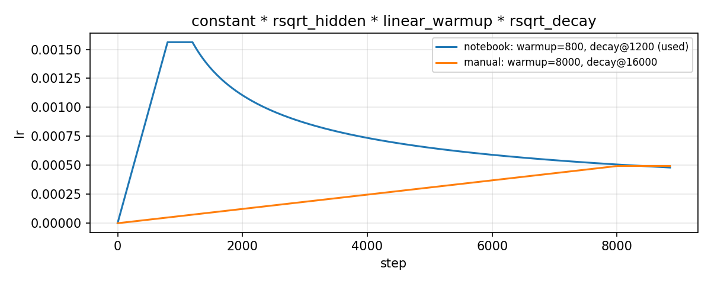

*图 2-1：notebook 实际使用的调度（800/1200）与实验手册原始配置（8000/16000）对比，后者在 8,850 步内一直处于 warmup 阶段。*

**（7）解码：Greedy 与 Beam Search**

推理要求 $\hat y=\arg\max_y\log P(y\mid x)$，但搜索空间随长度指数增长，只能近似求解。

- **Greedy**：每一步只保留概率最大的那个词。速度快，但一步选错就无法挽回。
- **Beam Search**：每一步保留累计对数概率最高的 $k$ 个前缀。每个前缀扩展 $V$ 个候选，共 $k\cdot V$ 个，再从中选出 top-$k$。$k=1$ 时退化为 Greedy。

累计对数概率是负数逐项相加，句子越长得分越低，所以 Beam Search 偏向输出短句。本实现在最后排序时用 GNMT 的长度惩罚做归一化：

$$
\mathrm{score}(y)=\frac{\log P(y\mid x)}{\left(\frac{5+|y|}{6}\right)^{\alpha}},\qquad \alpha=1.0
$$

**（8）评价指标：BLEU**

notebook 只打印译文，没有给出量化指标。本报告补充计算了 **字符级 corpus BLEU-4**：参考译文本身就是按字切分的，直接以字为单位计算，用 nltk 的 `corpus_bleu` 和 `SmoothingFunction().method1`：

$$
\mathrm{BLEU}=\mathrm{BP}\cdot\exp\Big(\sum_{n=1}^{4}\tfrac14\log p_n\Big),\qquad \mathrm{BP}=\min\!\left(1,\ e^{1-r/c}\right)
$$

$p_n$ 为 n-gram 修正精确率，$r$ 和 $c$ 分别为参考译文和系统输出的总长度。由于以字为单位，这里的 BLEU 数值不能和常见的中文词级 BLEU 直接比较，只用于本实验内部不同配置之间的对比。


### 具体算法

> （2）具体的算法，请用文字、示意图或者是伪代码等形式进行描述（不要贴大段的代码）

**（1）整体流程**

<Excalidraw src={pipelineUrl} height="1500px" />

*图 2-2：实验整体流程*

**（2）模型结构**

<Excalidraw src={transformerUrl} height="760px" />

**（3）训练一步（TransformerTrainOneStepCell）**


**（4）Beam Search 解码（BeamSearchDecoder）**


要点：

- 为了能在静态图（GRAPH_MODE）中运行，循环固定展开 $L$ 步，即使所有 beam 都已经结束也不会提前退出。这是推理首次编译约 8 分钟的主要原因。
- `TransformerDecoderStep` 没有 KV-cache，每一步都把完整前缀重新送入 6 层 Decoder，单句的计算量是 $O(L^2)$。
- 推理时交叉注意力的掩码是 `enc_mask[:,0:1,:] * ones(B, max_decode_length, 1)`，即每个目标位置都能看到全部有效的源位置，这是**正确**的写法。训练分支直接复用了 $A^{enc}$，两者**不一致**，见 2.3（4）。

**（5）学习率生成（create_dynamic_lr）**


### 程序开发中的重要技术细节

> （3）程序开发中重要的技术细节，比如用到了哪些重要的函数？这些函数来自于哪些基本库？功能是什么？自己编写了哪些功能函数？等等

**（1）`src/` 各模块分工**

- **`tokenization.py`**：`WhiteSpaceTokenizer`, `load_vocab_file`, `convert_by_vocab_dict`
  - 清理控制字符、统一空白字符，然后按空格切分。词表的行号就是 id，不在词表中的 token 一律映射为 `<unk>`（id 0）
- **`data_utils.py`**：`create_training_instance`, `write_instance_to_file`
  - 生成 `<s>`+句子 和 句子+`</s>` 两种序列，转成 id 并补齐到 40 位，同时生成 mask，写入 MindRecord
- **`transformer_model.py`**：`TransformerConfig`, `EmbeddingLookup`, `EmbeddingPostprocessor`, `MultiheadAttention`, `SelfAttention`, `FeedForward`, `EncoderCell`/`DecoderCell`, `TransformerEncoder`/`Decoder`, `CreateAttentionMaskFromInputMask`, `PredLogProbs`, `TransformerDecoderStep`, `TransformerModel`
  - 网络结构。`TransformerModel` 根据 `is_training` 构建不同分支：训练时 Decoder 一次处理整个序列，推理时为 `DecoderStep` 加 Beam Search
- **`beam_search.py`**：`BeamSearchDecoder`, `TileBeam`, `LengthPenalty`, `Mod`
  - 批量 Beam Search。`Mod` 用 `FloorDiv` 组合实现取模，原因是 MindSpore 早期图模式没有取模算子
- **`transformer_for_train.py`**：`TransformerTrainingLoss`, `TransformerNetworkWithLoss`, `TransformerTrainOneStepCell`, `ClipGradients`, `...WithLossScaleCell`
  - 计算损失，`GradOperation` 求梯度，逐张量做范数裁剪（5.0），可选分布式梯度归约和动态 loss scale
- **`lr_schedule.py`**：`create_dynamic_lr`
  - 生成逐步学习率列表
- **`train_util.py`**：`LossCallBack`
  - 每步打印 loss 并追加写入 `loss.log`
- **`weight_init.py`**：`weight_variable`, `normal_weight`
  - Dense 层用 Glorot 风格的均匀分布初始化，limit $=\sqrt{3/\mathrm{avg}(fan)}$；词向量用 $\mathcal N(0, d^{-1/2})$

**（2）实现细节**


1. **两种掩码的构造**：`CreateAttentionMaskFromInputMask` 用 `BatchMatMul([B,S,1],[B,1,S])` 把一维 mask 扩展成 $B\times S\times S$。因果掩码由 `np.tril` 生成，与 padding 掩码逐元素相乘后，在 `MultiheadAttention` 里转成 $(1-m)\times(-10000)$ 加到注意力分数上。
2. `load_dataset` 设置了 `shuffle=False`，`train_cfg.do_shuffle=True` 只是一个配置项，没有任何代码读取它。而 `ch_en_all.txt` 大致按句子长度由短到长排列（相邻两句满足非递减的比例为 68.9%）。所以每个 epoch 都是先训练短句再训练长句，loss 曲线呈锯齿状（见 3.3），每个 epoch 的最后几百步只更新长句，模型会偏向长句的分布。


## 3. Experiment Results

### 实验环境与操作步骤

> **步骤 0：环境准备**

按 notebook 第 0 节的说明，选择镜像 `mindspore_2.7.2-cann_8.5.2-py_3.11` 和规格 `1 * Ascend Snt9`，创建 Notebook 后上传 `mt_transformer_mindspore.ipynb`、`src/` 和 `data/`。在 Terminal 中写入 `mindspore_ascend_kernel.sh` 和 `kernel.json`，然后选择 `MindSpore Ascend` kernel。

> **步骤 1：导入依赖、设置运行环境（Cell 2–3）**

导入 MindSpore 的数据、网络、优化器、回调等模块以及 `src/` 下的各个模块，然后调用 `context.set_context(mode=GRAPH_MODE, device_target="Ascend")`，在昇腾上以静态图模式运行。这两个 Cell 只输出了一些 API 弃用警告，没有报错。

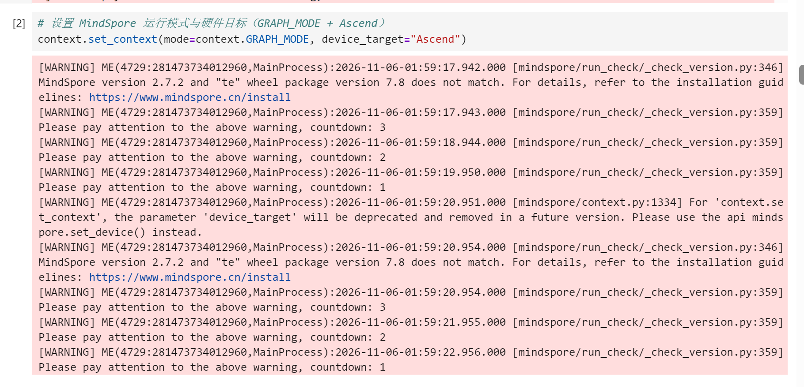

> **步骤 2：数据预处理（Cell 5–7）**

`data_cfg` 设置 `max_seq_length=40`、`clip_to_max_len=False`，即超过长度的句子直接丢弃，不做截断。`data_prepare` 逐行读取语料，完成分词、添加起止标记、转换为 id 和 mask，再按随机抽取的 20% 下标分别写入 `train.mindrecord` 和 `test.mindrecord`，同时把原句写入 `source_*.txt`，推理时用来对照。运行结束时输出 `finish 23607/23607`。

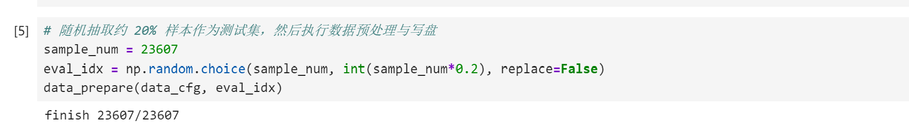

> **步骤 3：数据加载检查（Cell 9–10）**

用 `load_dataset` 读出第一条训练样本的 `source_eos_ids`，结果是 `[3983, 3, 2, 0, …, 0]`（长度 40），对应 `<一个英文词> . </s>`，后面用 0 补齐，与预期一致。

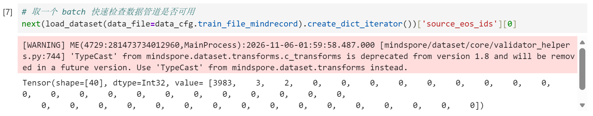

### 探索 1：token 与 id 映射、未登录词

notebook 默认例句 `我 喜 欢 这 门 课 程` 映射为 `[5, 104, 103, 23, 357, 814, 863]`。我另外测试了几种输入（`exp.py tok`）：

```text
输入: 我 喜 欢 这 门 课 程        
Tokens: ['我','喜','欢','这','门','课','程']   
IDs: [5, 104, 103, 23, 357, 814, 863]  OOV: []

输入: 我 喜欢 这门 课程           
Tokens: ['我','喜欢','这门','课程']            
IDs: [5, 0, 0, 0]                      OOV: ['喜欢','这门','课程']

输入: 浙 江 大 学                
Tokens: ['浙','江','大','学']                  
IDs: [0, 6467, 105, 99]                OOV: ['浙']

输入: I love natural language processing .   
IDs: [7, 539, 2843, 1070, 0, 3]                         OOV: ['processing']

输入: Tom can ' t speak Klingon .           
IDs: [25, 83, 8, 24, 400, 0, 3]                          OOV: ['Klingon']

输入: ChatGPT is cool 😀                     
IDs: [0, 21, 3081, 0]                                    OOV: ['ChatGPT','😀']
```


1. 词表结构：`ch_en_vocab.txt` 每行一个 token，行号即 id。前三个是特殊符号 `<unk>=0, <s>=1, </s>=2`，之后大致按词频从高到低排列：`.`=3、`。`=4、`我`=5、`的`=6、`I`=7……
2. 未登录词统一映射为 `<unk>`，id 为 0：`convert_by_vocab_dict` 查不到某个 token 时返回 `vocab_dict["<unk>"]`。padding 的 id 也是 0，两者只能靠 mask 区分，而 `<unk>` 的 mask 是 1，所以它仍然会被模型“看到”。
3. 分词粒度必须和词表一致：中文词表是按字建立的，如果输入按词切分（例如“喜欢”），即使每个字都在词表里，整个词也会变成 `<unk>`。分词器只按空格切分，所以推理时的预处理必须和训练语料保持一致：中文逐字加空格，英文中的缩写也要和语料一样写成 `can ' t`。
4. 英文按整词建表、没有子词切分，因此 `processing`、人名、品牌名都会变成 OOV；中文按字建表，只有罕见字才会 OOV。训练语料本身没有 OOV，但实际使用时 OOV 很常见，后果见 3.7。

### 思考题：`num_attention_heads` 从 8 改为 1

**（1）参数量不变**

`MultiheadAttention` 中 Q/K/V/O 四个投影矩阵的形状都是 $d\times(h\cdot d_k)$，而 `SelfAttention` 中 $d_k=d/h$，所以 $h\cdot d_k=d$ 恒成立，每个注意力块的参数量固定为 $4d^2=1{,}048{,}576$，**与头数无关**。改变头数只是改变 reshape 时把 $d$ 维切成几份。

**（2）表达能力的差别**

- **单头注意力每个位置只能输出一个注意力分布**，得到的是 value 的一个凸组合。如果一个词需要同时关注多个位置（句法上的中心词、对齐的源词、指代对象等），单头只能把权重分散，信息会被平均掉。多头可以在 8 个子空间里分别关注不同位置，再由 $W^O$ 组合起来。
- **单头的 $d_k=512$**，只有一种相似度度量；8 头相当于用 8 种秩为 64 的相似度度量组合。
- **数值稳定性也会变差**：$d_k$ 越大，点积 $q\cdot k$ 的方差越大。代码是先用 fp16 计算 $QK^\top$，再乘以 $1/\sqrt{d_k}$，所以单头时缩放前的数值更容易溢出。

**（3）实验验证**

两种头数在完全相同的配置下各训练 15 个 epoch：

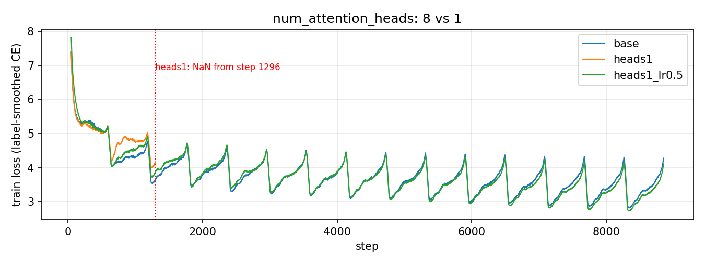

| 配置 | 结果 | 测试 BLEU（beam=4） |
|---|---|---|
| heads=8（base，lr×1.0） | 正常收敛，最后一个 epoch 平均 loss 3.385 | 4.58 |
| heads=1，lr×1.0 | **第 1296 步（学习率峰值附近）出现 NaN**，之后全部是 NaN，输出为 40 个相同的 token | 0.00 |
| heads=1，lr×0.5 | 正常收敛，最后一个 epoch 平均 loss 3.252 | 6.70 |

单头的参数量与 8 头完全相同，但在相同学习率下更容易数值发散。把学习率减半后单头可以正常训练。

### 模型训练

**（1）notebook baseline训练**

先调用 `create_dynamic_lr` 画出学习率曲线（Cell 18），再执行 `train(train_cfg)`（Cell 19）：

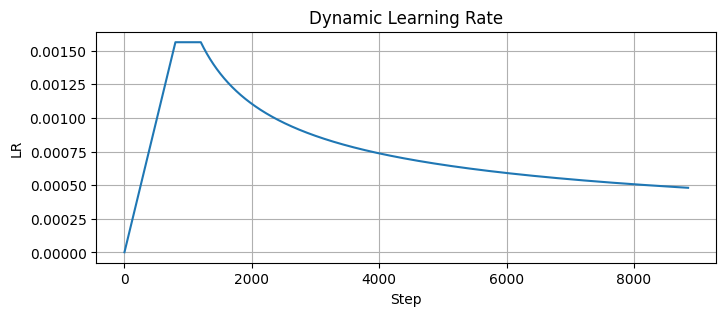

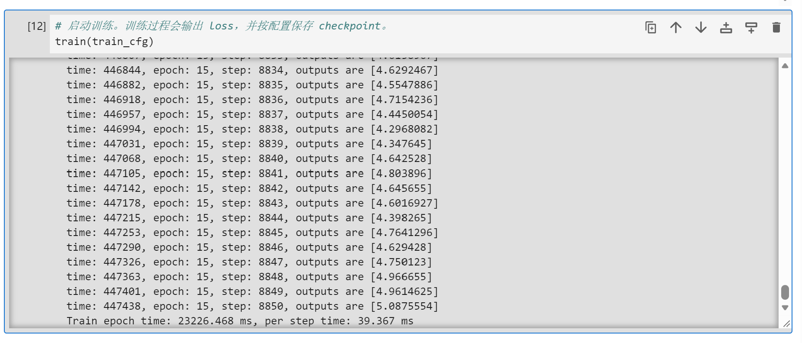


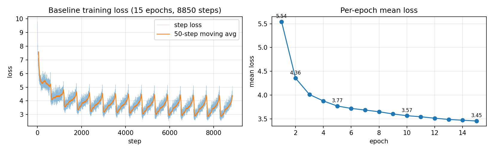

| epoch | 1 | 2 | 3 | 5 | 8 | 10 | 12 | 15 |
|---|---|---|---|---|---|---|---|---|
| 平均 loss | 5.544 | 4.356 | 4.012 | 3.770 | 3.649 | 3.567 | 3.514 | 3.455 |

loss 从 9.80 开始（约为 $\ln 10067=9.22$），第 1 个 epoch 平均降到 5.54，之后下降变慢，到第 15 个 epoch 平均为 3.455，**还没有收敛**。

**loss 呈锯齿形**：每个 epoch 内的 loss 都是先低后高，放大最后 3 个 epoch 可以看得很清楚：

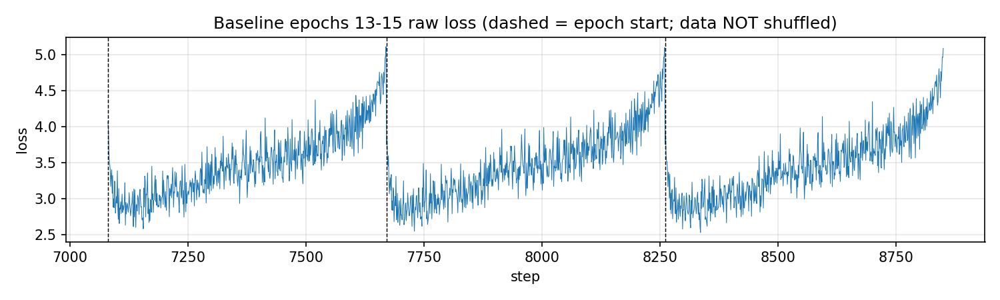

每个 epoch 开始时 loss 约 2.9，结束时升到 4.5–5.0，进入下一个 epoch 后又突然回落。原因是**训练数据没有打乱，而语料大致按句子长度排序**（见 2.3（3）第 5 点）：每个 epoch 都是先训练短句（容易，loss 低），再训练长句（难，loss 高）。所以 notebook 最后打印的 `loss=5.09` 只是最长那批句子的 loss，不能代表模型的整体水平。

**（2）`learning_rate` 探索**

学习率常数项分别取 ×0.5、×1.0（notebook 默认）、×2.0，其他设置与 notebook 相同：

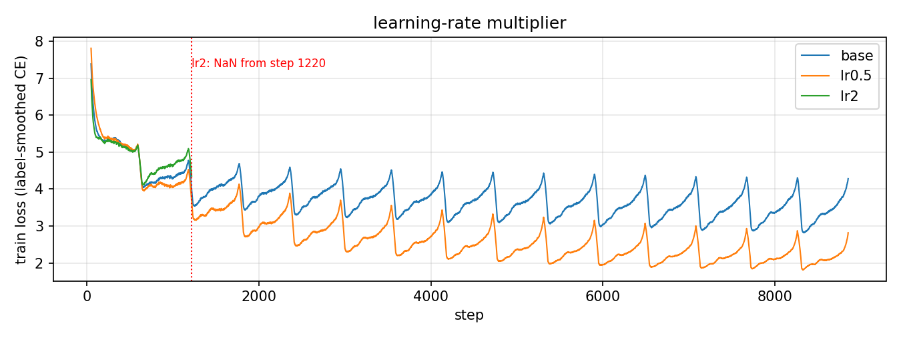

| 学习率倍率 | 峰值 lr | 最后一个 epoch 平均 loss | 测试 BLEU（beam=4） | 重复率 |
|---|---|---|---|---|
| ×0.5 | 0.78e-3 | **2.130** | **19.25** | 8.2% |
| ×1.0（base） | 1.56e-3 | 3.385 | 4.58 | 8.2% |
| ×2.0 | 3.12e-3 | 第 1220 步出现 NaN | 0.00 | 100% |

**结论**：在这个任务上，notebook 默认的学习率**偏大**。×2.0 在 warmup 刚结束时就数值发散了；×1.0 虽然没有发散，但长期停在较高的 loss；减半后 loss 明显更低，BLEU 从 4.6 提高到 19.3。原因在于 warmup 只有 800 步，比原论文的 4000 步短得多，学习率在模型还很不稳定的阶段就到达了峰值。而且本实验使用 fp16 计算且没有开启 loss scale，对过大的学习率更敏感。

**（3）`batch_size` 探索**

保持学习率调度不变（warmup 和 decay 按步数计），比较 batch_size 为 16、32、64：

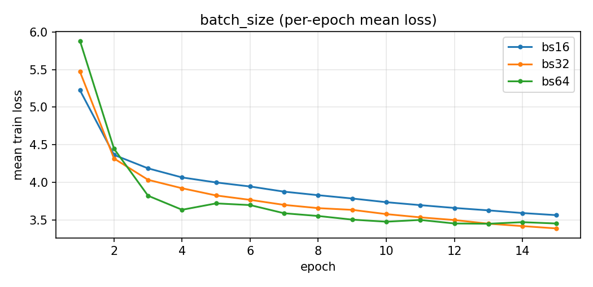

| batch_size | 每 epoch 步数 | 训练耗时 | 最后一个 epoch 平均 loss | 测试 BLEU（beam=4） |
|---|---|---|---|---|
| 16 | 1180 | 659 s | 3.561 | 2.44 |
| 32（base） | 590 | 422 s | 3.385 | 4.58 |
| 64 | 295 | 285 s | 3.450 | 6.32 |

**结论**：batch 越大，梯度噪声越小，相当于降低了“有效学习率”，所以 BLEU 随 batch 增大而上升，与 3.4（2）中“学习率偏大”的结论一致。bs=64 每个 epoch 只需 295 步，训练耗时仅为 bs=16 的 43%，说明 NPU 的并行能力在大 batch 下能更好地发挥。不过这三组的 BLEU 都还很低，整体上仍受 3.6 节所述的训练问题限制。

### 模型推理

**（1）notebook baseline推理结果**

执行 `evaluate(eval_cfg)`（Cell 23）。Beam Search 图第一次编译约需 4–8 分钟（输出中的一串 `.`），编译完成后，4,704 条测试句很快就推理完了。

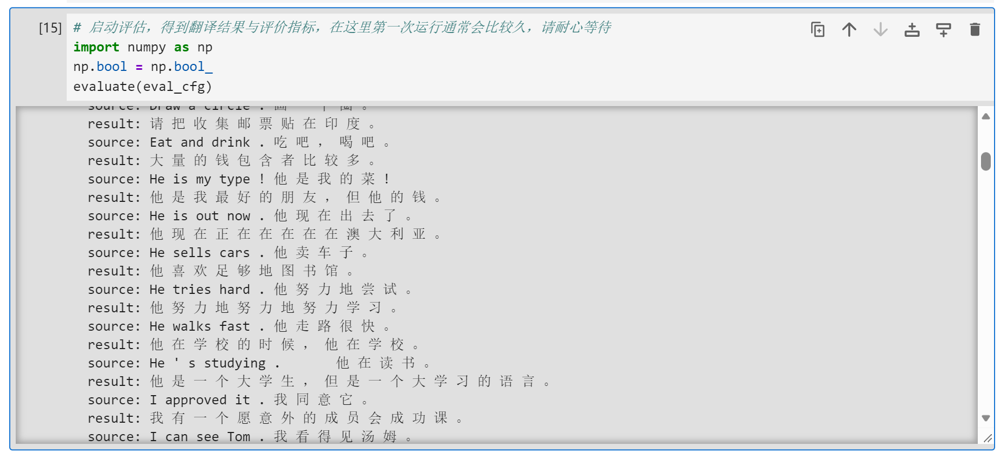
notebook 的输出只有译文，没有量化指标。我用 `score_tsv.py` 计算了以下指标：

| 指标 | 数值 |
|---|---|
| 字符级 BLEU-4 | **4.43** |
| BLEU-1 / BLEU-2 | 21.94 / 12.16 |
| 平均译文长度 / 参考长度（字） | 16.2 / 9.7 |
| 重复率 | 12.8% |
| 与参考完全一致 | 4 / 4704 |

能翻对的例子：`Please give me a glass of water .` → `请给我一杯水。`、`Tom looks very happy .` → `汤姆看起来非常开心。`（都与参考完全一致）。但大部分短句的译文与源句无关，例如 `Hi .` → `你最好立刻去医院。`，`Really ?` → `我在2000000…`。

（2）Greedy 与 Beam Search

对 notebook baseline和 3.6 节中效果最好的模型，分别用不同的 `beam_width` 在整个测试集上推理：

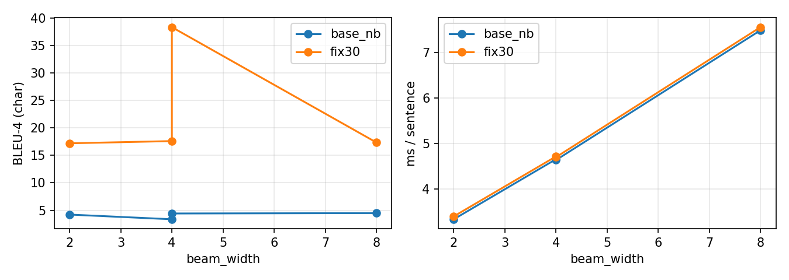


- **耗时**：解码耗时随 beam 宽度近似线性增加（3.3 → 4.6 → 7.5 ms/句），首次编译的时间也会变长。
- **质量**：beam 从 2 增加到 4，BLEU 小幅提高（+0.2 到 +0.4）；从 4 增加到 8 基本没有提升（fix30 甚至略有下降），重复率反而上升。这与已有研究的经验一致：beam 太大时，模型更容易找到“概率高但质量差”的输出，即 beam search curse。
- 综合来看，`beam_width=4` 是质量和速度之间比较合理的折中。模型本身的好坏（BLEU 4.4 vs 17.6）对结果的影响远大于解码策略。

### 拓展探索：模型为什么没有用到源句，以及如何修复

3.5 节中的现象说明模型**在很大程度上退化成了一个中文语言模型**。我认为有两个原因：

1. **训练分支中交叉注意力的掩码有误**：目标位置 $t\ge$ 源句长度时，该位置完全看不到源句。这会影响 74.7% 的训练句对、20.5% 的目标位置。
2. **训练数据没有打乱**：每个 epoch 末尾集中训练长句。

针对这两点分别修复，并按控制变量的方式对照：

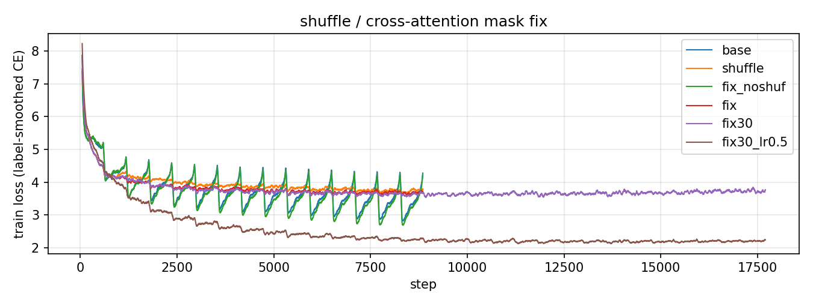

| 标签 | shuffle | 修复掩码 | epoch | lr 倍率 | 测试 BLEU | 重复率 | Δloss |
|---|---|---|---|---|---|---|---|
| baseline | ✗ | ✗ | 15 | 1.0 | 4.43  | 12.8% | 1.28 |
| fix_noshuf | ✗ | ✓ | 15 | 1.0 | 5.88 | 6.0% | — |
| shuffle | ✓ | ✗ | 15 | 1.0 | 8.45  | 7.0% | 1.60 |
| fix | ✓ | ✓ | 15 | 1.0 | 13.30 | 5.5% | 2.23 |
| fix30 | ✓ | ✓ | 30 | 1.0 | 17.60  | 1.8% | 2.79 |
| lr0.5 | ✗ | ✗ | 15 | 0.5 | 19.25  | 8.2% | 3.38 |
| **fix30_lr0.5** | ✓ | ✓ | 30 | 0.5 | **35.75** | **0.2%** | 3.35 |

为了方便，后续用*标签*一栏的内容代替。

**分析：**

1. **两项修复都有效，叠加后效果更明显**：只修复掩码，BLEU 从 4.6 提高到 5.9；只打乱数据，提高到 8.5；两者同时使用为 13.3，训练 30 个 epoch 后达到 17.6。诊断 Δloss 也从 1.23 增加到 2.79，说明模型越来越依赖源句。
2. **打乱数据后，各长度区间的 BLEU 恢复正常**：baseline中长句的 BLEU 反而高于短句，这是不正常的；打乱后短句的 BLEU 最高（26.1），随长度增加而下降。原来的反常是因为每个 epoch 最后几百步只训练长句，模型偏向输出长句的分布，短句就译成了长而无关的句子（baseline平均译文长度 16.2，参考只有 9.7）。
3. **学习率是影响最大的单一因素**：只把学习率减半，BLEU 就从 4.6 提高到 19.3。在此基础上再加上打乱数据、修复掩码、训练 30 个 epoch，**BLEU 达到 35.75，约为 notebook baseline的 8 倍**，重复率从 12.8% 降到 0.2%，平均译文长度（9.2）也接近参考长度（9.7）。
4. **训练集与测试集的差距**：在训练集的子集上，fix30 的 BLEU 为 38.3，baseline只有 3.4。baseline在训练集上同样很差，说明它的问题是**欠拟合或训练有误**，而不是过拟合。fix30 的训练集 BLEU（38.3）远高于测试集（17.6），说明修复后模型已经开始过拟合，这也和数据量只有 1.9 万句对相符。

**翻译样例对比**：

| 源句 | 参考 | notebook baseline | fix30_lr0.5 |
|---|---|---|---|
| Hi . | 嗨。 | 你最好立刻去医院。 | 嗨！ |
| I ' m OK . | 我没事。 | 我觉得我真的很难。 | 我好。 |
| I resign . | 我放弃。 | 我听到了一个小时的时候，但我被哭了。 | 我辞职了。 |
| Call me . | 联系我。 | 请让我看看看看看电话给我。 | 打电话给我。 |
| I learned to drive a car when I was eighteen and got a driver ' s license . | 我十八岁时，学了开车、考到了驾照。 | 我有一辆自行车。 | 我十八岁的时候开车，我到了驾驶执照。 |
| Tom thought that he had a chance to make a lot of money on the stock market . | 汤姆觉得他有机会在股市赚一大笔钱。 | 汤姆说他有很多钱。 | 汤姆认为他有很多钱在股市赚。 |

### 实验总结

1. 在 Ascend 910B 和 MindSpore 2.7.2 上完整跑通了 Transformer 英译中的数据处理、训练和 Beam Search 推理流程。notebook 原始配置训练 15 个 epoch 约需 7 分钟，测试集字符级 BLEU 为 **4.43**，大量译文与源句无关。
2. **探索 1**：词表的行号就是 id，前三个是 `<unk>/<s>/</s>`；OOV 和 padding 的 id 都是 0。推理时的分词粒度必须和训练语料完全一致，否则正常的词也会变成 `<unk>`。
3. **思考题**：头数从 8 改为 1，参数量完全不变（49,257,984），因为 Q/K/V/O 投影的总宽度始终是 $d$。区别在于模型能表达的注意力模式和数值稳定性：单头在原学习率下第 1296 步就发散成 NaN，学习率减半后才能正常训练。
4. **训练探索**：notebook 默认的学习率偏大（×2 发散，×0.5 时 BLEU 从 4.6 提高到 19.3）；batch 越大越稳定（bs64 的 BLEU 为 6.3）。“先升后降”的学习率调度中，warmup 用于稳定 Adam 在初期的二阶矩估计，避免发散；衰减用于后期收敛。
5. **推理探索**：解码耗时随 beam 宽度近似线性增加。beam=4 比 beam=2 略好，beam=8 基本没有提升，重复率反而上升，beam=4 是比较合理的折中。
6. **拓展**：我找出了 notebook 和代码中两处导致模型退化为语言模型的问题：训练时交叉注意力的掩码有误，以及 `do_shuffle` 没有生效。修复这两处并把学习率减半、训练 30 个 epoch 后，**BLEU 从 4.43 提高到 35.75**，重复率从 12.8% 降到 0.2%，模型能正确翻译日常短句并区分一词多义。剩余的主要瓶颈是 OOV、领域偏差和长句，需要通过子词切分、扩充数据和改进解码策略来解决。

## References

由 华为技术有限公司 出品的：

I. 《自然语言处理》机器翻译实验手册.

以及：

1. Vaswani, A., Shazeer, N., Parmar, N., Uszkoreit, J., Jones, L., Gomez, A. N., Kaiser, Ł., & Polosukhin, I. (2017). *Attention Is All You Need*. In Advances in Neural Information Processing Systems 30 (NIPS 2017), pp. 5998–6008. arXiv:1706.03762.
2. Sutskever, I., Vinyals, O., & Le, Q. V. (2014). *Sequence to Sequence Learning with Neural Networks*. In Advances in Neural Information Processing Systems 27 (NIPS 2014), pp. 3104–3112. arXiv:1409.3215.
3. Bahdanau, D., Cho, K., & Bengio, Y. (2015). *Neural Machine Translation by Jointly Learning to Align and Translate*. In International Conference on Learning Representations (ICLR 2015). arXiv:1409.0473.
4. Ba, J. L., Kiros, J. R., & Hinton, G. E. (2016). *Layer Normalization*. arXiv:1607.06450.
5. Srivastava, N., Hinton, G., Krizhevsky, A., Sutskever, I., & Salakhutdinov, R. (2014). *Dropout: A Simple Way to Prevent Neural Networks from Overfitting*. Journal of Machine Learning Research, 15(1), 1929–1958.
6. Kingma, D. P., & Ba, J. (2015). *Adam: A Method for Stochastic Optimization*. In International Conference on Learning Representations (ICLR 2015). arXiv:1412.6980.
7. Szegedy, C., Vanhoucke, V., Ioffe, S., Shlens, J., & Wojna, Z. (2016). *Rethinking the Inception Architecture for Computer Vision*. In IEEE Conference on Computer Vision and Pattern Recognition (CVPR 2016), pp. 2818–2826.
8. Papineni, K., Roukos, S., Ward, T., & Zhu, W.-J. (2002). *BLEU: a Method for Automatic Evaluation of Machine Translation*. In Annual Meeting of the Association for Computational Linguistics (ACL 2002), pp. 311–318.
9. Wu, Y., Schuster, M., Chen, Z., et al. (2016). *Google's Neural Machine Translation System: Bridging the Gap between Human and Machine Translation*. arXiv:1609.08144.
10. Press, O., & Wolf, L. (2017). *Using the Output Embedding to Improve Language Models*. In Proceedings of the 15th Conference of the European Chapter of the Association for Computational Linguistics: Volume 2, Short Papers (EACL 2017), pp. 157–163. arXiv:1608.05859.
11. Micikevicius, P., Narang, S., Alben, J., Diamos, G., Elsen, E., Garcia, D., Ginsburg, B., Houston, M., Kuchaiev, O., Venkatesh, G., & Wu, H. (2018). *Mixed Precision Training*. In International Conference on Learning Representations (ICLR 2018). arXiv:1710.03740.
12. Glorot, X., & Bengio, Y. (2010). *Understanding the Difficulty of Training Deep Feedforward Neural Networks*. In International Conference on Artificial Intelligence and Statistics (AISTATS 2010), pp. 249–256.
13. MindSpore. *MindSpore Documentation*. https://www.mindspore.cn/docs/
